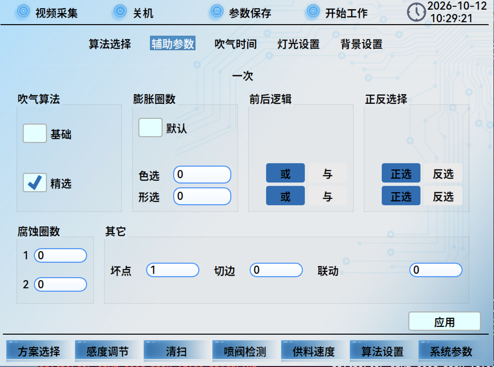
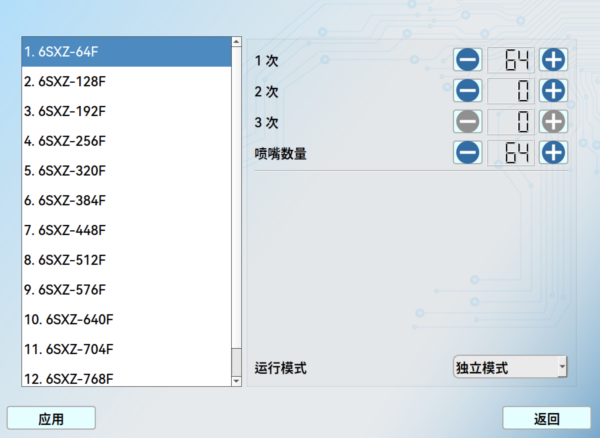
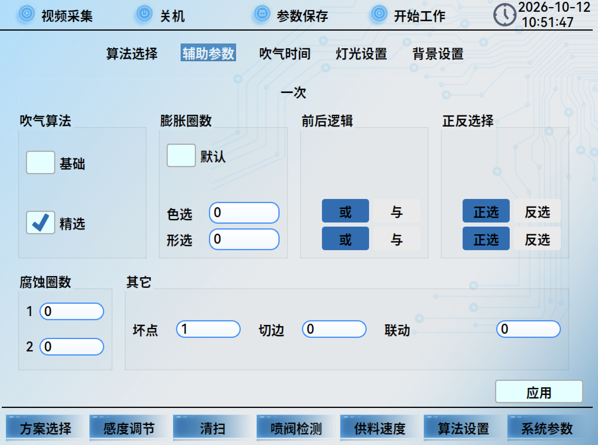

# DuySorter UI 完全教程（新手版 · 带插图）

> 读完这份文档，你应该能回答：
> 1. Qt 的资源文件（.qrc）是什么？为什么 `:/res/png/xxx.png` 前面有个冒号？
> 2. 图标从 PNG 文件到 QIcon 对象，中间经历了什么？
> 3. QSS 和 setStyleSheet 是什么关系？这个项目里为什么有 .qss 文件但没在用？
> 4. myPushButton、myLabel 这些自定义控件到底"自定义"了啥？
> 5. 主窗口 MainWidget 是怎么把一堆页面堆在一起的？

---

## 目录

1. [整体架构鸟瞰](#1-整体架构鸟瞰)
2. [项目实际界面长这样](#2-项目实际界面长这样)
3. [Qt 资源系统：图片、字体怎么被打包进程序](#3-qt-资源系统图片字体怎么被打包进程序)
4. [图标体系：从 PNG 文件到按钮上的那个图标](#4-图标体系从-png-文件到按钮上的那个图标)
5. [QSS / 样式表：像 CSS 一样给 Qt 控件化妆](#5-qss--样式表像-css-一样给-qt-控件化妆)
6. [自定义控件：myPushButton 到底封装了什么](#6-自定义控件mypushbutton-到底封装了什么)
7. [全局配置：尺寸、字体、颜色怎么统一管理](#7-全局配置尺寸字体颜色怎么统一管理)
8. [主窗口 MainWidget：UI 的骨架](#8-主窗口-mainwidgetui-的骨架)
9. [程序启动时发生了什么（按时间线）](#9-程序启动时发生了什么按时间线)
10. [实战：加一个新按钮到底要改哪几处](#10-实战加一个新按钮到底要改哪几处)
11. [为什么有 .qss 文件但没用上](#11-为什么有-qss-文件但没用上)

---

## 1. 整体架构鸟瞰

想象一个装修房子的场景：

| 装修概念 | 本项目对应 | 作用 |
|---------|----------|------|
| 砖瓦、木材（原材料） | `res/png/*.png`、`res/fonts/*.ttf` | 图片、字体文件 |
| 材料采购清单 | `res.qrc` | 告诉编译器"把这些文件打包进可执行文件" |
| 工具箱（方便拿取） | `MyIcon` 类 | 把所有 PNG 预加载成 QIcon 对象，代码里直接用 |
| 装修风格（壁纸、乳胶漆） | QSS / `setStyleSheet()` | 决定控件长什么样 |
| 预制家具（装修队做的柜子） | `myPushButton`、`myLabel` 等 | 封装好的自定义控件，一拿来就能用 |
| 房间布局（客厅、卧室怎么分） | `MainWidget` + `QStackedWidget` | 把各个页面组织起来 |

**关键认知**：这个项目**不是用 Qt Designer（.ui 文件）拖出来的界面**，而是**纯代码手工创建**的。所有按钮、标签、输入框都是 C++ `new` 出来的，位置和大小用布局管理器（Layout）或 `setGeometry` 来控制。

### UI 分层架构图

```
┌─────────────────────────────────────────────────────────────────────┐
│                        可执行文件 DuySorter                          │
│                                                                     │
│  ┌──────────────────────────────────────────────────────────────┐   │
│  │                     Qt 应用层                                 │   │
│  │                                                              │   │
│  │  main.cpp                                                    │   │
│  │    └──► MainWidget 主窗口 (1024×768 全屏无边框)               │   │
│  │            └──► QStackedWidget (一摞卡片, 一次只显示一张)      │   │
│  │                  ├── index 0:  主界面 (SM_HOME_PAGE)          │   │
│  │                  ├── index 1:  系统状态                      │   │
│  │                  ├── index 2:  方案选择                       │   │
│  │                  ├── index 6:  清灰设置                       │   │
│  │                  ├── index 7:  供料设置                       │   │
│  │                  ├── index 8:  喷阀自检                       │   │
│  │                  ├── index 4:  AI 智能分析                    │   │
│  │                  └── ... 共 20+ 个页面                        │   │
│  └──────────────────────────────────────────────────────────────┘   │
│                                                                     │
│  ┌──────────────────────────────────────────────────────────────┐   │
│  │                     控件层 (common/)                           │   │
│  │                                                              │   │
│  │  myPushButton    myLabel    mySlider    myInputPanel          │   │
│  │  (自定义按钮)    (自定义标签)  (自定义滑块)  (触摸软键盘)       │   │
│  │                                                              │   │
│  │  + QGridLayout / QVBoxLayout / QHBoxLayout (布局管理器)       │   │
│  └──────────────────────────────────────────────────────────────┘   │
│                                                                     │
│  ┌──────────────────────────────────────────────────────────────┐   │
│  │                     资源层                                    │   │
│  │                                                              │   │
│  │  res.qrc          📄 资源清单 (XML)                           │   │
│  │  res/png/*.png    🖼️ 200+ 图标/背景图片                       │   │
│  │  res/fonts/*.ttf  🔤 HarmonyOS Sans 字体                      │   │
│  │  MyIcon 单例      🧰 工具箱, 预加载所有 QIcon                  │   │
│  └──────────────────────────────────────────────────────────────┘   │
└─────────────────────────────────────────────────────────────────────┘
```

---

## 2. 项目实际界面长这样

在深入代码之前，先看看最终跑起来的效果。

### 实际运行界面截图

**图 2-1 · 吹气方式设置页面**（方案参数页的一部分）



> 顶部是状态栏（关机、保存、开始工作、时间），中间是"一次吹气"的参数面板（吹气算法、膨胀圈数、前后逻辑、正反选择），底部是功能切换 Tab。

**图 2-2 · 喷嘴数量设置页面**



> 另一组参数页面，可以看到项目的默认灰色调风格（不是 dark_tech.qss 的深色风）。

**图 2-3 · 前后视逻辑设置**



> 同样的控件样式全部来自内联 `setStyleSheet()`，并未加载 dark_tech.qss。

### UI 视觉构成分解

```
┌─────────────────────────────────────────────────────────────────┐
│               MainWidget  1024 × 768                             │
│  ╔═══════════════════════════════════════════════════════════╗  │
│  ║ 50px 顶部状态栏                                            ║  │
│  ║  ⏹ 关机   💾 参数保存   ▶ 开始工作    🕐 2026-11-10 08:30 ║  │
│  ╚═══════════════════════════════════════════════════════════╝  │
│  ╔═══════════════════════════════════════════════════════════╗  │
│  ║                                                           ║  │
│  ║                                                           ║  │
│  ║     ~658px 中间页面区                                       ║  │
│  ║     QStackedWidget 卡片堆 (一次只显示一张)                  ║  │
│  ║                                                           ║  │
│  ║     🔘按钮   📝标签   🔢输入框   🎚️滑块   📋列表            ║  │
│  ║                                                           ║  │
│  ║                                                           ║  │
│  ╚═══════════════════════════════════════════════════════════╝  │
│  ╔═══════════════════════════════════════════════════════════╗  │
│  ║ 60px 底部功能 Tab 栏                                       ║  │
│  ║  方案选择 | 感度调节 | 清扫 | 喷阀检测 | 供料 | 算法 | 系统 ║  │
│  ╚═══════════════════════════════════════════════════════════╝  │
└─────────────────────────────────────────────────────────────────┘
```

---

## 3. Qt 资源系统：图片、字体怎么被打包进程序

### 3.1 问题：为什么需要资源系统？

如果你在 C++ 代码里写 `QPixmap("/Users/me/project/res/png/Action_Apply.png")`：
- ✅ 开发时可以跑
- ❌ 部署到板子上就找不到了（板子上没有这个绝对路径）
- ❌ 就算路径改成相对的，用户随便删个文件程序就崩

**Qt 的解决方案**：把图片、字体等文件**编译进可执行文件本身**。这样程序跑到哪，资源就跟到哪。

### 打包流程（四步走）

```
┌──────────────┐     ┌──────────────┐     ┌──────────────┐     ┌──────────────┐
│ ① 磁盘文件    │     │ ② res.qrc    │     │ ③ rcc 编译器 │     │ ④ 可执行文件  │
│              │     │              │     │              │     │              │
│ res/png/     │ ───►│  XML 清单     │ ───►│  把所有文件   │ ───►│  DuySorter   │
│ Action_Apply │     │  列好所有    │     │  编码成 C++  │     │              │
│    .png      │     │  要打包的    │     │  字节数组    │     │  自带所有    │
│ HarmonyOS.ttf│     │  文件        │     │              │     │  图片和字体   │
└──────────────┘     └──────────────┘     └──────────────┘     └──────────────┘

                                                   │
                                                   ▼
                              编译时自动生成一个中间文件:
                              qrc_res.cpp  ← 里面全是字节数组
                                                   │
                                                   ▼
                                          被 g++ 链接进最终程序
```

运行时：
```
C++ 代码里写 QIcon(":/res/png/Action_Apply.png")
                      │
                      ▼
        Qt 从内存里的字节数组解码 PNG
                      │
                      ▼
                 得到 QIcon 对象  ✅
```

### 3.2 资源文件 res.qrc 是什么？

`res.qrc` 是一个 XML 文件，相当于"资源采购清单"。它告诉 Qt 的资源编译器（`rcc`）："把这些文件打包成一个 C++ 数组，编进最终的可执行文件里"。

### res.qrc 结构图解

```
<RCC>
├── <qresource prefix="/">          ← 统一前缀
│   ├── <file>res/png/Action_Apply.png</file>
│   ├── <file>res/png/Sorter_AI.png</file>
│   ├── <file>res/png/workStart.png</file>
│   ├── ... (200+ PNG 文件)
│   ├── <file>res/fonts/HarmonyOS_Sans_Medium.ttf</file>
│   └── ... (19 个字体文件)
└── </RCC>

最终资源路径 = prefix "/" + 文件路径
举例:  :/res/png/Action_Apply.png     ← 冒号开头!
       :/res/fonts/HarmonyOS_Sans_Medium.ttf
```

### 3.3 `:/` 冒号是什么意思？

这是 Qt 资源系统的标志。文件系统路径是 `/home/mcgs/xxx.png`，**资源路径以 `:/` 开头**，表示"这不是文件系统上的文件，是编进程序里的资源"。

记住这个规则：

```
文件系统路径：  /home/mcgs/Desktop/DuySorter_rk3566/res/png/Action_Apply.png
资源路径：      :/res/png/Action_Apply.png   ← 冒号冒号!
```

### 3.4 res.qrc 怎么被编进项目？

在 `DuySorter.pro` 里有一行：
```
RESOURCES += res.qrc
```

qmake 看到这行后，会自动调用 Qt 的资源编译器 `rcc`，把 res.qrc 里列的所有文件打包成一个 `qrc_res.cpp`，再编译链接进最终的 DuySorter 可执行文件。

### 3.5 ⚠️ 哪些资源"没有"被打包？

注意：`res/qss/` 下的三个文件（`pagefold.qss`、`coffee.qss`、`dark_tech.qss`）**没有出现在 res.qrc 里**！这意味着它们不会被打包进程序，也不会被自动加载。后面会详细说为什么。

---

## 4. 图标体系：从 PNG 文件到按钮上的那个图标

### 4.1 整体流程

```
磁盘上的 Action_Apply.png
    │
    ▼
① 在 res.qrc 里声明 <file>res/png/Action_Apply.png</file>
    │
    ▼
② 编译时被 rcc 打包进可执行文件
    │
    ▼
③ C++ 代码里从内存解码:
   QIcon(":/res/png/Action_Apply.png")
    │
    ▼
④ 在 MyIcon::init() 里预加载到全局单例:
   myIcon.Action_Apply = QIcon(":/res/png/Action_Apply.png")
    │
    ├──► ④a setIcon()       给按钮左上角加小图标
    └──► ④b border-image    整块按钮铺背景图 (切图状态切换)
```

### 4.2 MyIcon 全局单例：方便拿图标

每次要一个图标都写 `QIcon(":/res/png/xxx.png")` 太啰嗦了。项目里用了一个 **MyIcon** 类，把所有图标预加载好，放到一个全局单例里。

```
┌─────────────────────────────────────────────┐
│           myicon.h                          │
│                                             │
│  class MyIcon {                             │
│    QIcon Action_Apply;      ← 成员变量      │
│    QIcon Action_Back;                       │
│    QIcon Sorter;                            │
│    QIcon Sorter_AI;                         │
│    QIcon System_Shutdown;                   │
│    QIcon Flag_CN;                           │
│    // ... 约 100 个 QIcon                   │
│                                             │
│    void init();        ← 唯一入口函数       │
│  };                                         │
│                                             │
│  extern MyIcon myIcon;  ← 全局声明          │
└─────────────────────────────────────────────┘
                   │
                   ▼
┌─────────────────────────────────────────────┐
│           myicon.cpp                        │
│                                             │
│  MyIcon myIcon;        ← 唯一实例 (全局变量) │
│                                             │
│  void MyIcon::init() {                      │
│    Action_Apply = QIcon(                    │
│        ":/res/png/Action_Apply.png");       │
│    Action_Back = QIcon(                     │
│        ":/res/png/Action_Back.png");        │
│    Sorter = QIcon(                          │
│        ":/res/png/Sorter.png");             │
│    // ... 一行加载一个图标                   │
│  }                                          │
└─────────────────────────────────────────────┘
```

### 4.3 在代码里使用图标

**方式一：setIcon 给按钮加图标（小图标）**

```cpp
// 构造时直接传
myPushButton* btn = new myPushButton("方案选择",
                                      myIcon.Sorter_SchemeSelect,
                                      this);

// 最终效果：
// ┌──────────────┐
// │ 🔍 方案选择  │    ← 左边图标 右边文字
// └──────────────┘
```

**方式二：border-image 整块按钮背景图（切图）**

```cpp
// 项目里大量用这种方式!
btn->setStyleSheet(
    "QPushButton { border-image: url(:/res/png/selectPress.png); }");

// 用户按下时切换另一张图（两个状态两张图）
btn->setStyleSheet(
    "QPushButton { border-image: url(:/res/png/selectUnpress.png); }");
```

### 4.4 项目里的两种图标风格

**风格 A：功能图标（小图标 setIcon）**

| 分组 | 命名前缀 | 实际图片 |
|-----|---------|---------|
| Action 操作 | `Action_` |    |
| Arrow 箭头 | `Arrow_` |    |
| Sorter 色选功能 | `Sorter_` |    |
| System 系统 | `System_` |    |
| Device 硬件 | `Device_` |    |
| Flag 语言 | `Flag_` |    |
| Message 提示 | `Message_` |   |

**风格 B：按钮整块背景图（border-image 切图）**

按状态成对出现：

| 未按下状态 | 按下状态 | 用途 |
|-----------|---------|------|
|  |  | 可选中/切换状态的按钮 |
|  |  | 工作停止 / 工作启动 |
|  |  | 返回按钮（普通/选中） |
|  | — | 设置按钮 |
|  | — | 关机按钮 |

### 4.5 命名规律

```
res/png/
├── Action_XXX.png     ← 操作类（Apply, Cancel, Refresh...）
├── Arrow_XXX.png      ← 箭头（Left, Right, Up, Down...）
├── Sorter_XXX.png     ← 色选机功能（AI, Feeder, Camera...）
├── System_XXX.png     ← 系统类（Shutdown, Lock, Calendar...）
├── Device_XXX.png     ← 硬件设备（Camera, Network, Chip...）
├── Flag_XXX.png       ← 国旗（CN, KR, VN, TH...）
├── Message_XXX.png    ← 弹窗提示（Error, Warning, Info...）
├── Chart_XXX.png      ← 图表类型（Bar, Line, Pie...）
├── Edit_XXX.png       ← 编辑操作（Copy, Save, Delete...）
├── *Select / select*  ← 按钮状态图（按下/未按）
└── workStart/Stop     ← 特殊功能按钮图
```

---

## 5. QSS / 样式表：像 CSS 一样给 Qt 控件化妆

### 5.1 什么是 QSS？

QSS（Qt Style Sheets）就是 Qt 版的 CSS（网页样式表）。语法几乎一模一样：

```
/* CSS 写法（网页） */                               /* QSS 写法（Qt） */
button { background: red; border-radius: 5px; }      QPushButton { background: red; border-radius: 5px; }
```

### 5.2 QSS 能做什么？

```
┌─────────────────────────────────────────────────────────┐
│                     QSS 能力地图                          │
│                                                         │
│  颜色 ──► 背景色 / 文字色 / 边框色                       │
│  形状 ──► 圆角 / 边框粗细 / 虚线实线                     │
│  图片 ──► border-image (整块铺图)                        │
│          background-image (背景贴图)                     │
│  渐变 ──► qlineargradient (线性渐变)                    │
│  状态 ──► :hover   鼠标悬停时                           │
│          :pressed  按下时                                │
│          :disabled 禁用时                                │
│          :checked  选中时                                │
│  精准选择 ──► #objectName      按对象名选                │
│             [p='true']        按动态属性选               │
└─────────────────────────────────────────────────────────┘
```

### 5.3 两种使用方式

**方式一：全局样式表（整个程序用同一份 .qss 文件）**

```cpp
// 在 main.cpp 或 MainWidget 构造函数里
QFile file(":/dark_tech.qss");   // 从资源里读
file.open(QFile::ReadOnly);
QString styleSheet = QLatin1String(file.readAll());
qApp->setStyleSheet(styleSheet);  // 全局生效, 所有控件自动套用
```

**方式二：局部内联样式（这个项目主要用的方式）**

```cpp
// 某个页面里, 只给这个按钮设样式
btn->setStyleSheet("QPushButton { background-color: transparent; border: none; }");
```

### 5.4 QSS 选择器速查

| 写法 | 含义 | 实际例子 |
|-----|------|---------|
| `QPushButton` | 所有这个类型的控件 | `QPushButton { background-color: lightcyan; }` |
| `#btnPrimary` | 这个 objectName 的控件 | `btn->setObjectName("btnPrimary")` 后只有它被选中 |
| `[primary="true"]` | 带这个动态属性的控件 | `btn->setProperty("primary", true)` 配合 dark_tech.qss |
| `:hover` | 鼠标悬停时 | `QPushButton:hover { color: red; }` |
| `:pressed` | 按下时 | `QPushButton:pressed { padding-top: 5px; }` |
| `:checked` | 选中时（checkable 按钮） | `QPushButton:checked { background: blue; }` |

### 5.5 dark_tech.qss 内容图解

项目里有一份写好了但**还没接入**的深色科技风 QSS，设计来源是 `UI参考/色选机深度学习操作台AI+色选.html`：

```
┌────────────────────────────────────────────────────────────┐
│  dark_tech.qss 设计变量                                     │
│                                                            │
│  ── 主题色 ──                                               │
│  主色  #22d3ee  ░░░░░░  按钮主色、选中高亮                  │
│  次色  #3b82f6  ██████  渐变终点、辅助高亮                  │
│  成功  #34d399  ▓▓▓▓▓▓  绿色状态                           │
│  危险  #f87171  ██████  红色警告                           │
│  警告  #fbbf24  ░░░░░░  黄色提醒                           │
│                                                            │
│  ── 背景色 ──                                               │
│  全局底  #050a14  ░░░░░░                                   │
│  面板底  rgba(12,22,38,.78)  毛玻璃效果                    │
│                                                            │
│  ── 文字色 ──                                               │
│  主文字  #e2edfb  (在暗底上清晰可读)                       │
│  次文字  #7d93b2  (弱化显示)                               │
│                                                            │
│  字体 HarmonyOS Sans SC                                    │
└────────────────────────────────────────────────────────────┘
```

### 5.6 三个 .qss 文件状态对比

```
┌─────────────────┐   ┌────────────┐   ┌────────────┐   ┌──────────────────────────┐
│ 文件            │   │ res.qrc    │   │ 代码加载   │   │ 实际状态                 │
├─────────────────┤   ├────────────┤   ├────────────┤   ├──────────────────────────┤
│ pagefold.qss    │ ─►│ ❌ 未引用   │ ─►│ ❌ 未加载   │ ─►│ 📚 Qt 官方示例模板       │
│ coffee.qss      │ ─►│ ❌ 未引用   │ ─►│ ❌ 未加载   │ ─►│ 📚 Qt 官方示例模板       │
│ dark_tech.qss   │ ─►│ ❌ 未引用   │ ─►│ ❌ 未加载   │ ─►│ ✨ 新版深色风 写好待接入 │
└─────────────────┘   └────────────┘   └────────────┘   └──────────────────────────┘
```

### 5.7 项目当前实际用的样式方案

```
┌───────────────────────────────────────────────────────────┐
│              当前在用 ✅                                    │
│                                                           │
│  ① myPushButton::setBasicStyle()                          │
│     所有自定义按钮自动套基础样式                           │
│     (背景色 + 边框 + 对齐 + 按下偏移)                     │
│                                                           │
│  ② 各页面内联 setStyleSheet()                              │
│     如: btn->setStyleSheet("background-color:transparent; │
│                             border:none;")                 │
│                                                           │
│  ③ border-image 切图                                      │
│     selectPress.png / selectUnpress.png                   │
│     按状态换整块背景图                                     │
│                                                           │
│  ④ 几个全局颜色常量                                        │
│     g_style1 = 浅灰  rgb(220,220,220)                     │
│     g_style2 = 中灰  rgb(190,190,190)                     │
│     g_style3 = 深灰  rgb(150,150,150)                     │
│     g_styleRed = 红色                                      │
│     g_styleGreen = 绿色                                    │
└───────────────────────────────────────────────────────────┘

┌───────────────────────────────────────────────────────────┐
│              待接入 ⏳                                      │
│                                                           │
│  res/qss/dark_tech.qss  ✨ 新版深色科技风                 │
│  res/qss/pagefold.qss   📚 参考模板                       │
│  res/qss/coffee.qss     📚 参考模板                       │
└───────────────────────────────────────────────────────────┘
```

---

## 6. 自定义控件：myPushButton 到底封装了什么

### 6.1 为什么要自定义控件？

QPushButton 是 Qt 自带的按钮。但如果每个按钮都要：
- 设字体（项目统一的字体）
- 设图标大小（项目统一的 40x40）
- 设尺寸策略
- 设基础样式（边框、背景色、对齐）

那每个 `new QPushButton` 后面都要写 6~8 行重复代码。**自定义控件就是把这些"默认配置"封装好**，一行就能用。

### 6.2 myPushButton 构造流程

```
new myPushButton("方案选择", icon, parent)
        │
        ▼
  QPushButton(parent)          ← 先调父类构造
        │
        ▼
  config = g_Config::getInstance()   ← 拿全局配置单例
        │
        ▼
  setText("方案选择")          ← 设置显示文字
        │
        ▼
  setFont(config->getFont())   ← 统一字体 (22号, HarmonyOS Sans)
        │
        ▼
  setIcon(icon)                ← 设置图标
        │
        ▼
  setIconSize(QSize(40, 40))   ← 图标大小统一 40×40 像素
        │
        ▼
  setSizePolicy(Expanding, Expanding)  ← 布局里自动扩展
        │
        ▼
  ⭐ setBasicStyle()           ← 关键! 拼 QSS 字符串, 设基础样式
```

### 6.3 setBasicStyle() 内部逻辑

```
setBasicStyle() 做三件事:

① 判断对齐方式
   ├── 有图标 + 有文字 → 左对齐 (text-align: left)
   └── 纯图标 / 纯文字 → 居中对齐 (text-align: center)

② 选择背景色 (根据构造时传入的 Color 参数)
   ├── RED    → strColor = "deepskyblue"   (虽然叫 RED 实际是深蓝)
   ├── GREEN  → strColor = "deeppink"      (虽然叫 GREEN 实际是粉红)
   └── DEF    → strColor = "lightcyan"     (默认浅青)

③ 拼 QSS 字符串, 一次性 setStyleSheet
   QString strStyle = QString(
       "QPushButton {"
       "   text-align: %1;"
       "   background-color: %2;"
       "   border-color: #afafaf;"
       "   border-width: 2px;"
       "   border-style: solid;"
       "   border-radius: 5;"
       "}"
       "QPushButton:pressed {"
       "   padding-left: 5px;"
       "   padding-top: 5px;"
       "   background-color: lightgrey;"
       "}").arg(strAlign).arg(strColor);
   setStyleSheet(strStyle);
```

### 6.4 自定义控件继承树

```
Qt 原生控件                    项目自定义控件 (common/)
─────────────────────────────────────────────────────────────
QPushButton  ─────────────────►  myPushButton  ⭐ 最常用
                                定制内容: 统一字体、图标大小、
                                         边框样式、按下偏移

QLabel  ──────────────────────►  myLabel
                                定制内容: 统一字体

QLineEdit  ──────────────────►  myLineEdit
                                定制内容: 统一字体 + 软键盘集成

QSlider  ─────────────────────►  mySlider
                                定制内容: 统一滑块样式

QListWidget  ─────────────────►  myListWidget
                                定制内容: 统一列表样式

QGroupBox  ───────────────────►  myGroupBox
                                定制内容: 组框标题和边框

QCheckBox  ───────────────────►  myCustomCheckBox
                                定制内容: 自定义外观

QWidget  ─────────────────────►  myInputPanel
                                定制内容: 触摸软键盘面板
```

---

## 7. 全局配置：尺寸、字体、颜色怎么统一管理

### 7.1 屏幕尺寸（LCD_WIDTH / LCD_HEIGHT）

在 `DuySorter.pro` 里定义：
```
DEFINES += LCD_WIDTH=1024 LCD_HEIGHT=768
```

这意味着整个项目假设屏幕是 **1024×768** 像素的触摸屏板卡。

### 屏幕尺寸分区图

```
┌──────────────────────────────────────────────────────────┐
│                    1024 px 宽                              │
│  ╔═════════════════════════════════════════════════════╗ │
│  ║                 50px 状态栏                          ║ │
│  ║  关机 | 保存 | 开始工作 | 时间                       ║ │
│  ╚═════════════════════════════════════════════════════╝ │
│  ╔═════════════════════════════════════════════════════╗ │
│  ║                                                     ║ │
│  ║                                                     ║ │
│  ║              ~658px 中间页面区                       ║ │
│  ║              QStackedWidget 卡片堆                    ║ │
│  ║                                                     ║ │
│  ║                                                     ║ │
│  ╚═════════════════════════════════════════════════════╝ │
│  ╔═════════════════════════════════════════════════════╗ │
│  ║                 60px 底部Tab栏                        ║ │
│  ║  方案选择 | 感度调节 | 清扫 | 喷阀 | 供料 | 算法 | 系统║ │
│  ╚═════════════════════════════════════════════════════╝ │
│                  总高 768 px                               │
└──────────────────────────────────────────────────────────┘
```

MainWidget 构造时直接锁死：
```cpp
setGeometry(0, 0, LCD_WIDTH, LCD_HEIGHT);   // 固定位置和大小
setFixedSize(QSize(LCD_WIDTH, LCD_HEIGHT)); // 禁止用户 resize
```

### 7.2 控件尺寸宏（globalconfig.h）

```cpp
// 图标大小 (所有按钮上的图标统一)
#define ICON_WID        40
#define ICON_HEI        40

// 默认按钮尺寸
#define BTN_WIDTH       150
#define BTN_HEIGHT      40
#define SMALL_BTN_WIDTH 50
#define DEFAULT_BTN_WIDTH 120
#define BIG_BTN_WIDTH   250

// 页面内大按钮 (方案选择那种)
#define PAGE_BTN_WIDTH  350
#define PAGE_BTN_HEIGHT 60

// Tab 栏
#define TAB_HEIGHT      45
```

### 7.3 颜色常量（全局变量，include 就能用）

```cpp
// globalconfig.h

const QString g_style1 = "background-color: rgb(220,220,220);";   // 浅灰
const QString g_style2 = "background-color: rgb(190,190,190);";   // 中灰
const QString g_style3 = "background-color: rgb(150,150,150);";   // 深灰
const QString g_styleRed    = "background-color: rgb(255,0,0);";
const QString g_styleGreen  = "background-color: rgb(0,255,0);";
const QString g_styleBlue   = "background-color: rgb(0,0,255);";
```

### 7.4 字体管理流程

```
步骤 1: main.cpp 里注册字体文件 (10 个 HarmonyOS Sans 变体)
    │
    │  QFontDatabase::addApplicationFont(
    │      ":/res/fonts/HarmonyOS_Sans_Medium.ttf");
    │  注册了: Regular, Medium, Bold, Light, Semibold...
    │
    ▼
步骤 2: 自定义控件里 config->getFont() 拿统一字体
    │
    │  setFont(config->getFont(DEFAULT_FONT_SIZE));
    │
    ▼
步骤 3: g_Config 单例根据语言返回对应字体
    │
    ├── 泰文 → Leelawadee
    ├── 阿拉伯/波斯/维吾尔 → Tahoma
    ├── 孟加拉 → Vrinda
    └── 其他 → HarmonyOS Sans Medium (22号)
```

---

## 8. 主窗口 MainWidget：UI 的骨架

### 8.1 MainWidget 是什么

`MainWidget` 是程序**唯一的主窗口**，全屏 1024×768 无边框（`Qt::FramelessWindowHint`）。所有页面都是它里面的子 Widget。

### 8.2 QStackedWidget：翻页的核心

Qt 的 QStackedWidget 像"一摞卡片"——一次只显示一张，用 `setCurrentIndex(n)` 切换。

```
QStackedWidget 卡片堆 (一次只显示一张)
═══════════════════════════════════════

  ┌─────────────────────────────┐
  │ index 0  SM_HOME_PAGE       │  ◄── 默认显示这张 (主界面)
  │         主界面               │
  └─────────────────────────────┘
  ┌─────────────────────────────┐
  │ index 1  SM_STATUS_INFO     │
  │         系统状态             │
  └─────────────────────────────┘
  ┌─────────────────────────────┐
  │ index 2  SM_SELECT_SCHEME   │
  │         方案选择             │
  └─────────────────────────────┘
  ┌─────────────────────────────┐
  │ index 6  SM_SET_WIPE        │
  │         清灰设置             │
  └─────────────────────────────┘
  ┌─────────────────────────────┐
  │ index 7  SM_SET_FEED        │
  │         供料设置             │
  └─────────────────────────────┘
  ┌─────────────────────────────┐
  │ index 8  SM_TEST_EJECT      │
  │         喷阀自检             │
  └─────────────────────────────┘
  ┌─────────────────────────────┐
  │ index 4  SM_AI_PAGE         │
  │         AI智能分析           │
  └─────────────────────────────┘
  ┌─────────────────────────────┐
  │ ... 共 20+ 个页面            │
  └─────────────────────────────┘

  切页: stackedWidget->setCurrentIndex(2);  ◄── 跳到方案选择
```

### 8.3 页面切换的两种方式

**方式一：直接 setCurrentIndex（最常用）**

```cpp
// 声明槽函数
private slots:
    void onSelectSchemeBtnClickedSlt();

// 实现槽函数
void MainWidget::onSelectSchemeBtnClickedSlt() {
    // 切到方案选择页面
    stackedWidget->setCurrentIndex(SM_SELECT_SCHEME_PAGE);
}

// 连接信号 (构造函数里)
connect(selectSchemeBtn, SIGNAL(clicked()),
        this, SLOT(onSelectSchemeBtnClickedSlt()));

// 用户点按钮 → Qt 发射 clicked() 信号 → 槽函数收到 → 切页
```

**方式二：信号发射（跨页面通信）**

```cpp
// 子页面里发射信号
emit goToHomePageSig();

// MainWidget 里连接 (在某个 CreateXXXWidget 里)
connect(this, SIGNAL(goToHomePageSig()),
        this, SLOT(GoToHomePageSlt()));

// 这种方式适合页面 A 不直接知道页面 B 存在的场景
```

### 8.4 页面创建的通用套路

```cpp
void MainWidget::CreateSetFeedWidget() {

    // ① 创建页面容器
    pageSetFeed = new QWidget(this);

    // ② 创建布局管理器 (网格布局最常用)
    QGridLayout* grid = new QGridLayout(pageSetFeed);

    // ③ 创建控件 (统一用自定义控件)
    myLabel*      title    = new myLabel("供料设置", pageSetFeed);
    mySlider*     slider   = new mySlider(pageSetFeed);
    myLineEdit*   speed    = new myLineEdit(pageSetFeed);
    myPushButton* cancel   = new myPushButton("取消", QIcon(""), pageSetFeed);

    // ④ 把控件放进布局
    // grid.addWidget(控件, 行, 列, 跨行数, 跨列数)
    grid->addWidget(title,    0, 0, 1, 3);   // 第0行, 占3列 (居中大标题)
    grid->addWidget(slider,   1, 0, 1, 3);   // 第1行, 占3列 (横向铺满)
    grid->addWidget(cancel,   2, 1);          // 第2行, 中间位置

    // ⑤ 连接信号槽 (点取消 → 回主界面)
    connect(cancel, SIGNAL(clicked()),
            this, SLOT(onCancelSetFeedBtnClickedSlt()));

    // ⑥ 最后塞进堆叠器
    stackedWidget->addWidget(pageSetFeed);   // index = 6? 取决于add顺序
}
```

### 8.5 完整 MainWidget 初始化流程

```
MainWidget w  (构造函数执行)
    │
    ├── myIcon.init()                          加载 100+ 个 QIcon
    │
    ├── new updateStatusThread                  创建后台线程
    ├── new getStatusThread
    ├── thread->start()                         启动线程
    │
    ├── CreateHomeWidget()                      创建主界面
    │   └── new pageHome + 10+ myPushButton
    │   └── stackedWidget->addWidget(pageHome)  → index 0
    │
    ├── CreateSetFeedWidget()                   创建供料设置
    │   └── new pageSetFeed + slider + lineedit
    │   └── stackedWidget->addWidget(pageSetFeed) → index 7
    │
    ├── CreateSetWipeWidget()                   创建清灰设置 → index 6
    ├── CreateTestEjectWidget()                 创建喷阀自检 → index 8
    ├── CreateAIPageWidget()                    创建 AI 页面  → index 4
    ├── ... 20+ 个页面全部创建                  按 addWidget 顺序分配 index
    │
    └── createXxxTable() × 5                    创建 SQLite 数据表
```

---

## 9. 程序启动时发生了什么（按时间线）

```
 时间 ─────────────────────────────────────────────────────────────────►

 [OS]  操作系统: ./DuySorter  (双击或命令行启动)
   │
   ▼
 [1]  main.cpp 入口函数
   │
   ├─ AA_DontUseNativeDialogs  禁用板卡 GTK3 原生文件对话框 (会卡死)
   │
   ├─ myApplication a(argc, argv)  创建 Qt 应用实例
   │
   ├─ LOG_INIT()  初始化日志系统
   ├─ SQLiteMgr::Init()  初始化数据库连接
   ├─ ConfigMgr::Init()  初始化 AI 配置
   │
   ├─ ⭐ 关键! 注册字体 (必须在 MainWidget 之前!)
   │   QFontDatabase::addApplicationFont 注册 10 个 HarmonyOS Sans 变体
   │   ┌─────────────────────────────────────────────────────┐
   │   │ 如果漏掉这步, 自定义控件 setFont("HarmonyOS Sans")   │
   │   │ 会找不到字体, 回退到系统默认, 导致 UI 错乱:          │
   │   │   · 控件尺寸变大                                     │
   │   │   · 整体布局下移                                     │
   │   │   · 文字截断                                         │
   │   └─────────────────────────────────────────────────────┘
   │
   ├─ Loading.gif 全屏显示  启动动画
   │
   ├─ myFlow.initAll()  读取所有 .conf 配置文件
   │
   ├─ a.setFont(getFont())  全局设置 HarmonyOS Sans
   │
   ├─ ⭐ 创建主窗口
   │   MainWidget w
   │     ├─ myIcon.init()              加载 100+ 图标
   │     ├─ 启动后台线程               updateStatus / getStatus
   │     ├─ CreateXXWidget() × 20+     创建所有页面
   │     └─ stackedWidget->addWidget   页面入栈
   │
   ├─ QTimer::singleShot(2000, ...)    2秒后:
   │   ├─ w.showFullScreen()           显示主窗口
   │   └─ 关闭 Loading 动画
   │
   └─ a.exec()                         进入事件循环 (等待用户点击)

 用户界面 ──► 程序收到 SIGNAL ──► 触发 SLOT ──► 执行逻辑 ──► 更新 UI
```

---

## 10. 实战：加一个新按钮到底要改哪几处

假设你要在主界面加一个"诊断"按钮，**完整流程**：

### 步骤流程图

```
┌─────────────────────────────────────────────────────────────┐
│ ① 准备图标                                                   │
│   把 Diagnose.png 放到 res/png/ 目录                          │
└────────────────────┬────────────────────────────────────────┘
                     ▼
┌─────────────────────────────────────────────────────────────┐
│ ② 注册资源                                                   │
│   改 res.qrc, 加一行:                                         │
│   <file>res/png/Diagnose.png</file>                           │
└────────────────────┬────────────────────────────────────────┘
                     ▼
┌─────────────────────────────────────────────────────────────┐
│ ③ 声明图标                                                   │
│   改 src/myicon.h, 加成员变量:                                │
│   QIcon Sorter_Diagnose;                                      │
└────────────────────┬────────────────────────────────────────┘
                     ▼
┌─────────────────────────────────────────────────────────────┐
│ ④ 加载图标                                                   │
│   改 src/myicon.cpp 的 init() 里, 加一行:                    │
│   Sorter_Diagnose = QIcon(":/res/png/Diagnose.png");          │
└────────────────────┬────────────────────────────────────────┘
                     ▼
┌─────────────────────────────────────────────────────────────┐
│ ⑤ 声明按钮                                                   │
│   改 src/mainwidget.h, 加成员指针:                            │
│   myPushButton* diagnoseBtn;                                  │
└────────────────────┬────────────────────────────────────────┘
                     ▼
┌─────────────────────────────────────────────────────────────┐
│ ⑥ 声明槽函数                                                 │
│   改 src/mainwidget.h 的 private slots: 里加:                │
│   void onDiagnoseBtnClickedSlt();                             │
└────────────────────┬────────────────────────────────────────┘
                     ▼
┌─────────────────────────────────────────────────────────────┐
│ ⑦ 创建按钮 + 实现槽函数 + 连接信号                            │
│   改 src/mainwidget.cpp:                                      │
│                                                               │
│   // 构造函数里, 其他按钮旁边加:                               │
│   diagnoseBtn = new myPushButton("诊断",                      │
│                                  myIcon.Sorter_Diagnose,      │
│                                  this);                       │
│   operatePageHBLayout->addWidget(diagnoseBtn);                │
│   connect(diagnoseBtn, SIGNAL(clicked()),                     │
│           this, SLOT(onDiagnoseBtnClickedSlt()));             │
│                                                               │
│   // 实现槽函数:                                              │
│   void MainWidget::onDiagnoseBtnClickedSlt() {                │
│       qDebug() << "诊断按钮被点了!";                           │
│       // 切页面: stackedWidget->setCurrentIndex(...);         │
│       // 或做其他事...                                         │
│   }                                                           │
└────────────────────┬────────────────────────────────────────┘
                     ▼
┌─────────────────────────────────────────────────────────────┐
│ ⑧ 编译验证                                                   │
│   ./qtmakeApp.sh release 6SXZ-600G_335X                       │
│   (或用远程编译: ssh_connect → upload_files → build_duyi)    │
└─────────────────────────────────────────────────────────────┘
```

### 完整 Checklist

| 步骤 | 文件 | 操作 |
|-----|------|------|
| 准备图标 | `res/png/` | 放入 XXX.png 🆕 新文件 |
| ① 注册资源 | `res.qrc` | `<file>res/png/XXX.png</file>` ✏️ 修改 |
| ② 声明图标 | `src/myicon.h` | `QIcon XXX;` 成员 ✏️ 修改 |
| ③ 加载图标 | `src/myicon.cpp` | `XXX = QIcon(":/res/png/XXX.png");` ✏️ 修改 |
| ④ 声明按钮 | `src/mainwidget.h` | `myPushButton* xxxBtn;` 成员 ✏️ 修改 |
| ⑤ 声明槽函数 | `src/mainwidget.h` | `void onXxxBtnClickedSlt();` ✏️ 修改 |
| ⑥ 创建按钮 | `src/mainwidget.cpp` | `new myPushButton + addWidget` ✏️ 修改 |
| ⑦ 实现槽函数 | `src/mainwidget.cpp` | 点击后要做的事 ✏️ 修改 |
| ⑧ 连接信号 | `src/mainwidget.cpp` | `connect(btn, SIGNAL, SLOT)` ✏️ 修改 |
| ⑨ 编译 | `qtmakeApp.sh` | 一键编译 ⚙️ 命令 |

### 每个新 UI 元素要"登记"的地方总结

```
图片文件 ──► res.qrc ──► myicon.h ──► myicon.cpp ──► mainwidget.h ──► mainwidget.cpp
  │            │          │              │               │                │
  │            │          │              │               │                ├── new
  │            │          │              │               │                ├── addWidget
  │            │          │              │               │                └── connect
  │            │          │              │               │
  │            │          │              │               └── 槽函数声明
  │            │          │              │
  │            │          │              └── init() 加载一行
  │            │          │
  │            │          └── QIcon 成员声明
  │            │
  │            └── <file> 标签
  │
  └── 放 res/png/ 目录
```

---

## 11. 为什么有 .qss 文件但没用上

前面提过，三个 .qss 文件**不在 res.qrc 里，也没有任何代码加载它们**。原因是：

| 文件 | 来源 | 状态 |
|-----|------|------|
| `pagefold.qss` | Qt 官方 Style Sheet 示例（WindowsXP 复古风） | 📚 项目保留作参考模板 |
| `coffee.qss` | Qt 官方 Style Sheet 示例（米色咖啡风） | 📚 项目保留作参考模板 |
| `dark_tech.qss` | 为新版 AI 深色调写的 | ⏳ 写好了但没接入 |

### 要接入 dark_tech.qss 需要做的三件事

```
当前状态                              需要做的事
═══════════════════                  ════════════════════════════════════
res.qrc 里没有 dark_tech.qss    ──►  ① res.qrc 里加一行
                                         <file>res/qss/dark_tech.qss</file>

main.cpp 里没有 setStyleSheet    ──►  ② main.cpp 里加载 QSS 文件
                                         QFile f(":/res/qss/dark_tech.qss");
                                         qApp->setStyleSheet(f.readAll());

各页面仍在用内联 setStyleSheet   ──►  ③ 清理冲突的内联样式
                                        旧的 btn->setStyleSheet(...) 会
                                        覆盖全局 QSS, 需要逐步删除
```

---

## 速查表

### 想做什么？改哪里？

| 想做什么 | 改哪个文件 | 怎么改 |
|---------|-----------|--------|
| 加一张图片资源 | `res/png/` + `res.qrc` | 放 PNG + 加 `<file>` 标签 |
| 用图标 | 直接 `myIcon.XXX` | 或 `QIcon(":/res/png/xxx.png")` |
| 改按钮样式 | `myPushButton::setBasicStyle()` | 或 `btn->setStyleSheet("...")` |
| 改全局字体颜色 | `globalconfig.h` 的 `g_style1/g_style2...` | 或 `main.cpp` 的 `getFont()` |
| 改按钮大小 | `globalconfig.h` 的 `BTN_WIDTH/ICON_WID...` | 或 `g_Config::getInstance()->setBtnSize()` |
| 加新页面 | MainWidget 里加 `CreateXxxWidget` | `stackedWidget->addWidget(newPage)` |
| 切页面 | `stackedWidget->setCurrentIndex(SM_XXX_PAGE)` | 枚举在 mainwidget.h |
| 加新按钮 | .h 声明 + .cpp new + connect | 见第 10 章 checklist |
| 查屏幕尺寸 | `LCD_WIDTH` / `LCD_HEIGHT` | 定义在 DuySorter.pro |
| 注册字体 | `main.cpp` | `QFontDatabase::addApplicationFont()` |

### 项目目录速查

```
duyisorter_xinxin3568/
│
├── res/                              ⭐ 所有资源
│   ├── png/                          200+ 图标/背景
│   │                                 (Action_*, Arrow_*, Sorter_*,
│   │                                  System_*, Device_*, Flag_*,
│   │                                  Message_*, select*, work*)
│   │
│   ├── qss/                          ⚠️ 三个 qss 文件, 都没接入
│   │   ├── pagefold.qss              Qt 官方示例 (WindowsXP 风格)
│   │   ├── coffee.qss                Qt 官方示例 (米色咖啡风)
│   │   └── dark_tech.qss             ✨ 新版深色科技风 (写好待接入)
│   │
│   ├── fonts/                        19 个 HarmonyOS Sans 字体
│   └── html/                         嵌入式 ECharts 统计页面
│
├── res.qrc                           ⭐⭐⭐ 资源清单 (加图/加字体必须改这个)
├── DuySorter.pro                     qmake 项目 (定义 LCD_WIDTH=1024 等)
│
├── src/
│   ├── main.cpp                      ⭐ 程序入口、字体注册、Loading 动画
│   ├── mainwidget.h / .cpp           ⭐⭐⭐ 主窗口, 所有页面在这里组装
│   ├── myicon.h / .cpp               ⭐⭐ 全局图标单例 (100+ QIcon)
│   │
│   ├── common/                       ⭐ 自定义控件库
│   │   ├── globalconfig.h / .cpp     尺寸宏、颜色常量、字体配置
│   │   ├── mypushbutton.*            自定义按钮 (统一字体/样式/图标)
│   │   ├── mylabel.*                 自定义标签
│   │   ├── mylineedit.*              自定义输入框
│   │   ├── myslider.*                自定义滑块
│   │   ├── mylcdnumber.*             自定义 LCD 数字
│   │   ├── mylistwidget.*            自定义列表
│   │   ├── mygroupbox.*              自定义组框
│   │   ├── myinputpanel.*            软键盘面板
│   │   ├── mycustomcheckbox.*        自定义复选框
│   │   └── ...
│   │
│   ├── rgb/                          各种功能页面 Widget
│   │   ├── schemeParams/             方案参数页面
│   │   ├── setcolorcamera.*          相机设置
│   │   ├── aimainwidget.*            AI 分析
│   │   └── ...
│   │
│   └── 3rdparty/                     第三方库 (🚫 禁止修改!)
│
├── doc/                              📚 文档 + 界面截图
│   ├── 前后视逻辑设置.png            实际 UI 截图
│   ├── 喷嘴数量设置.png
│   ├── 吹气方式设置.png
│   └── ...
│
└── qtmakeApp.sh                      🚀 一键编译脚本
```

### 概念对照表

| 术语 | 简单解释 | 类比 |
|-----|---------|------|
| `.qrc` | Qt 资源清单 XML 文件 | 快递装箱单 |
| `:/xxx` | Qt 资源路径（冒号开头） | 虚拟文件系统 |
| `QIcon` | Qt 的图标对象 | 图片的"方便拿"包装 |
| `MyIcon` | 全局图标仓库单例 | 厨房调料架 |
| `QSS` | Qt 样式表（CSS 语法） | 墙面涂料 |
| `setStyleSheet()` | 在某个控件上刷 QSS | 给某件家具单独刷漆 |
| `QStackedWidget` | 一摞卡片式容器 | 幻灯片翻页 |
| `myPushButton` | 封装好的按钮（默认配置） | 预制柜子 |
| `g_Config` | 全局配置单例（尺寸/字体） | 装修手册 |
| `CSingletonBase` | 单例模板类 | 保证全局只有一份配置 |
| `addApplicationFont` | 向 Qt 注册字体 | 往字体库放字体文件 |
| `connect(SIGNAL, SLOT)` | Qt 信号槽连接 | 按钮按下 → 触发某个函数 |
| `setCurrentIndex` | QStackedWidget 翻页 | 翻到第几页幻灯片 |
| `addWidget` | 把控件加进容器/布局 | 把家具搬进房间 |
| `QGridLayout` | 网格布局管理器 | 贴墙砖时的网格线 |
