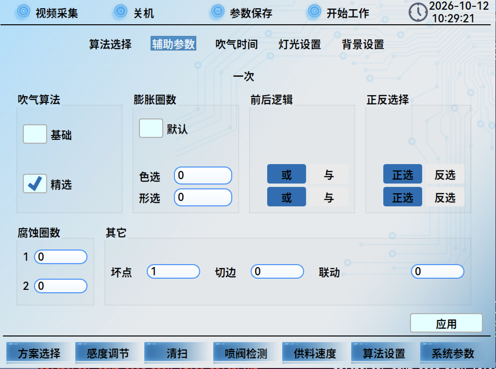
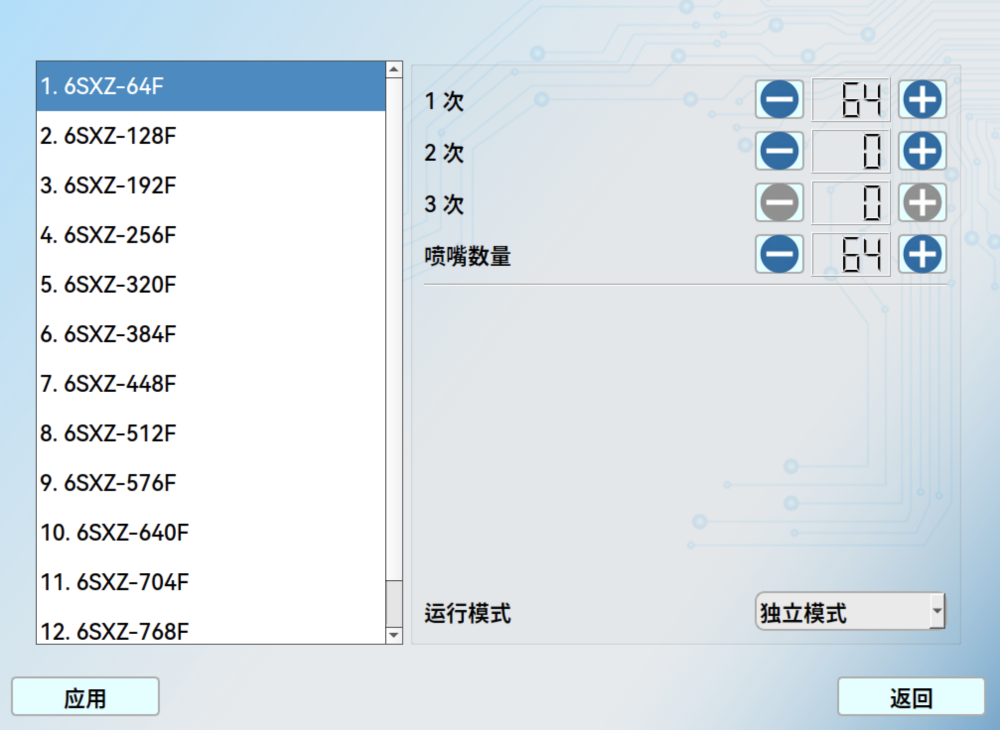
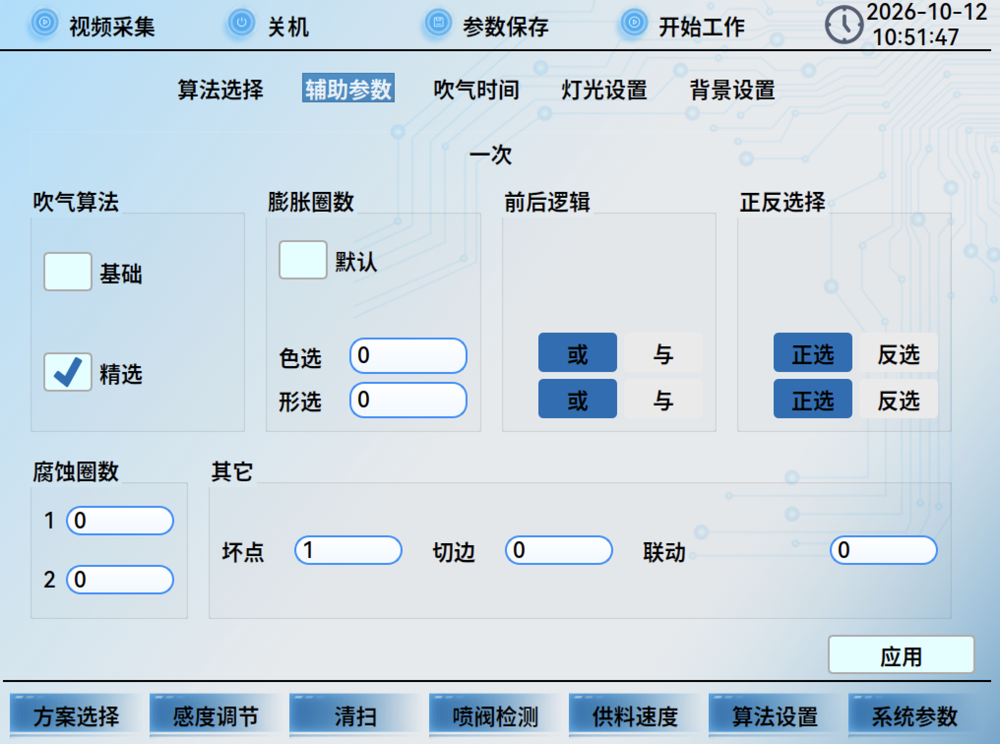

# 协议解读

## 喷阀检测

喷阀自检的指令序列，取决于 `struCnfp.enableAi` 的值，主程序走两条完全互斥的链路。

### 链路 A：直接串口 FPGA（enableAi == false）

主程序不发送 CMD_INT_ONOFF 前置指令，直接循环发 `CMD_INT_EJTEST (0x03)`。

| 步骤 | 指令 | com1Write 参数 | 含义 |
|---|---|---|---|
| 1 | `CMD_INT_EJTEST (0x03)` | `INT, level, 0, 0x01, 0, 0, valve/256, valve%256, 3` | **开阀**（arg4=0x01） |
| 2 | `msleep(ejectTestInterval)` | 高速=100ms，低速=300ms | 保持开阀 |
| 3 | `CMD_INT_EJTEST (0x03)` | `INT, level, 0, 0x00, 0, 0, valve/256, valve%256, 3` | **关阀**（arg4=0x00） |
| 4 | `msleep(ejectTestInterval2)` | 高速=50ms，低速=100ms | 阀间歇 |

逐号递增（1→nMaxEjector），非循环模式跑到头就停。

独立 test 程序（test_main.cpp mode=5）额外加了前置：

```cpp
// 先确保接口板进入工作态
for (int i = 0; i < struCnfg.nInterfaceBoardTotal; i++)
    MySerial.com1Write(CMD_INT_ONOFF, INT, i, 0, 0, 0, 0, 0, 1, 3);
```

然后 msleep(200) 后才开始发 EJTEST。因为独立 test 程序启动时接口板可能还不在工作态，主程序正常运行期间接口板一直是工作态所以省了这步。

### 链路 B：AI 板 UDP（enableAi == true）

不走串口，走 UDP 9193 端口。

| 步骤 | 指令 | 含义 |
|---|---|---|
| 1 | `StartFixCheckRequest(FixedCheckParam{valve=0, injector=N, interval=aiEjectDelayTime})` | AI 板开始点喷 |
| 2 | `msleep(interval/2)` | 喷半拍 |
| 3 | `StopFixCheckRequest(...)` | AI 板停止点喷 |
| 4 | `msleep(interval/2)` | 阀间歇 |

### 退出 / 取消

用户按取消按钮（`onCancelTestEjectBtnClickedSlt`），先发 `threadStart->stop()` 停线程，然后给当前最后一个喷阀发一条 `CMD_INT_EJTEST ... 0x00 ...`（关阀指令），确保不会有阀卡在开状态。

### 杂粮机型分支（link 模式）

链路 A 的杂粮机型分支（`getProductLineNo() == 0`）把喷阀分到两块接口板：前半阀由 `struGsh.nLevel` 控制，后半阀由 `struGsh.nLevel + 1` 控制，其他参数完全一样。

### 协议码定义（myqextserialport.h）

```cpp
#define CMD_INT_ONOFF      0x01   // 运行开始/停止
#define CMD_INT_EJTIME     0x02   // 喷阀时间
#define CMD_INT_EJTEST     0x03   // 喷阀自检
#define CMD_INT_EJECT_WIDTH  0x04 // 吹气模式
#define CMD_INT_EJECTOR_SET  0x05 // 喷嘴数量
#define CMD_INT_EJECTOR_COUNT 0x06 // 吹气频率
```

`com1Write` 签名：

```cpp
int com1Write(int nCmd, char sModuleType, char sIntAddr, char sUnitAddr,
              char arg1, char arg2, char arg3, char arg4, char arg5, int nCount);
```

### 相关源码文件

| 文件 | 作用 |
|---|---|
| `src/myqextserialport.h` | 协议码定义、com1Write 声明 |
| `src/mainwidget.cpp: ejectPageThreadStartSlt` | 喷阀自检主循环（链路 A / B 分叉点） |
| `src/mainwidget.cpp: onCancelTestEjectBtnClickedSlt` | 取消喷阀自检 |
| `test/test_main.cpp: test_valve_direct` | 独立 test 程序 mode=5，直连 FPGA 串口 |

---

## 吹气方式设置

吹气方式（固定 / 自适应）通过 UI 上"基础" / "精选"两个单选按钮选择，保存方案时逐组下发到接口板。

### UI 位置

导航路径：**主界面 → 模式设置 → 辅助参数 Tab → 吹气算法组**



- **组框标题**：吹气算法（`myLan.eject_mode`）
- **两个选项**：基础（`fixed_mode`）、精选（`extended_mode`）
- **默认值**：精选（自适应）

### UI 与存储字段映射

| UI 选项 | 存储字段                           | 值     | 含义      |
| ----- | ------------------------------ | ----- | ------- |
| 基础    | `struGroupTick[i][j].nEjwidth` | **1** | 固定吹气宽度  |
| 精选    | 同上                             | **4** | 自适应吹气宽度 |

槽函数 `PageTick::setHuffModeSlt(int index)` 做这个映射（`src/rgb/schemeparams/tick.cpp:217-229`）：

```cpp
void PageTick::setHuffModeSlt(int index)
{
    switch (index) {
    case 0: m_struGroupTick[...].nEjwidth = 1; break;  // 基础 → 固定
    case 1: m_struGroupTick[...].nEjwidth = 4; break;  // 精选 → 自适应
    }
}
```

信号连接：`connect(huffModeValue, SIGNAL(currentChanged(int)), this, SLOT(setHuffModeSlt(int)))`

### 协议下发（globalflow.cpp:1560）

保存方案参数时，按每个剔除组（`struGroupTick[i][j]`）分别下发：

```cpp
MySerial.com1Write(CMD_INT_EJECT_WIDTH, INT, i, nUnitAddr,
                   0, 0, 0, 0,
                   struCnfp.struGroupTick[i][j].nEjwidth, 3);
```

| 参数 | 值 | 含义 |
|---|---|---|
| `nCmd` | `CMD_INT_EJECT_WIDTH (0x04)` | 吹气模式协议码 |
| `sModuleType` | `INT` | 接口板模块 |
| `sIntAddr` | `i` | 接口板索引 |
| `sUnitAddr` | `nUnitAddr` | 剔除组地址 |
| **arg5** | **1 或 4** | **吹气方式（固定 / 自适应）** |
| `nCount` | `3` | 数据长度 |

下发粒度：逐剔除组，不是整机统一。不同剔除组可以独立设置吹气方式。

### 默认值（globalflow.cpp:690）

新建方案时默认自适应：

```cpp
struCnfp.struGroupTick[i][j].nEjwidth = 4;   // 默认精选/自适应
```

### 相关源码文件

| 文件 | 作用 |
|---|---|
| `src/rgb/schemeparams/tick.cpp` | PageTick 页面，UI 创建 + setHuffModeSlt 槽函数 |
| `src/globalflow.cpp:1560` | 协议下发 |
| `src/globalflow.cpp:690` | 默认值 |
| `src/myqextserialport.h:40` | `CMD_INT_EJECT_WIDTH = 0x04` 定义 |

---

## 喷嘴数量及长度设置

喷嘴数量是整机硬件结构参数，**所有通道共用同一个值**，不按层 / 按通道分别存储。

### UI 位置

导航路径：**主界面 → 工厂设置 → 机型设置页面**



- **页面**：机型设置（左侧机型列表 1~12，右侧显示 1次/2次/3次 的层参数 + 喷嘴数量）
- **喷嘴数量**：独立输入框（-/+ 按钮调节），当前默认 64
- **调节范围**：41 ~ 79（`setmachinemode.cpp:704-722` 的边界判断）
- **"长度"** 在此 UI 里**没有独立设置项** —— 喷嘴数量即对应硬件结构，长度由物理喷阀决定，软件不下发

### 存储字段

| 字段 | 位置 | 粒度 |
|---|---|---|
| `struCnfg.nEjectorsPerChute` | `globalparams.h` | **整机一个值**，所有接口板共享 |

UI 读写：

```cpp
// 读取
m_nEjectNumPerBoard = struCnfg.nEjectorsPerChute;   // setmachinemode.cpp:87

// 写入（机型配置应用时）
struCnfg.nEjectorsPerChute = m_nEjectNumPerBoard;   // setmachinemode.cpp:759
```

### 协议下发（globalflow.cpp:783-787）

初始化 / 参数同步时，**循环所有接口板，发同一个值**：

```cpp
for (i = 0; i < struCnfg.nInterfaceBoardTotal; i++)
{
    /* 发送给接口板的喷嘴数量 */
    MySerial.com1Write(CMD_INT_EJECTOR_SET, INT, i, 0, 0, 0,
                       struCnfg.nEjectorsPerChute - 1,   // arg3, 0 基数
                       0, 0, 3);
}
```

| 参数 | 值 | 含义 |
|---|---|---|
| `nCmd` | `CMD_INT_EJECTOR_SET (0x05)` | 喷嘴数量协议码 |
| `sModuleType` | `INT` | 接口板模块 |
| `sIntAddr` | `i` | 接口板索引（循环 `nInterfaceBoardTotal`） |
| `sUnitAddr` | `0` | — |
| **arg3** | **`nEjectorsPerChute - 1`** | 喷嘴数量（接口板内部 0 基数，所以 -1） |
| `nCount` | `3` | 数据长度 |

### 与吹气方式的粒度对比

| 参数 | 存储字段 | 粒度 |
|---|---|---|
| **喷嘴数量** | `struCnfg.nEjectorsPerChute` | **整机一个值**，所有通道一致 |
| **吹气方式（固定 / 自适应）** | `struGroupTick[i][j].nEjwidth` | **逐剔除组**，可以不同 |

截图里的"运行模式：独立模式"指通道之间的**算法逻辑**独立（正反选、前后视关系等），但喷嘴数量是硬件结构参数，整机统一，不在此分化。

### 协议码定义（myqextserialport.h）

```cpp
#define CMD_INT_EJECTOR_SET     0x05   // 喷嘴数量
#define CMD_INT_EJECTOR_COUNT   0x06   // 吹气频率
```

### 相关源码文件

| 文件 | 作用 |
|---|---|
| `src/rgb/setmachinemode.cpp` | 机型设置页面 UI，`onEjectMinusBtnClicked` / `onEjectPlusBtnClicked` / `setLevelParams` |
| `src/globalflow.cpp:783-787` | 协议下发（循环接口板） |
| `src/myqextserialport.h:41` | `CMD_INT_EJECTOR_SET = 0x05` 定义 |
| `src/globalparams.h` | `struCnfg.nEjectorsPerChute` 字段声明 |

---

## 前后视逻辑（与 / 或关系）设置

前后视逻辑决定**前视相机与后视相机**在色选 / 形选判定时的组合关系：是**都满足才剔除（与）**，还是**任一满足就剔除（或）**。色选和形选有独立的两行设置。

### UI 位置

导航路径：**主界面 → 模式设置 → 辅助参数 Tab → 前后逻辑组**



- **组框标题**：前后逻辑（`myLan.logical_relation`）
- **第一排**：色选前后视关系 —— ○ 或 / ○ 与
- **第二排**：形选前后视关系 —— ○ 或 / ○ 与（UI 上显示为两行 **或 与** 按钮对）

### UI 与存储字段映射（tick.cpp:232-234）

```cpp
/* 响应前后视关系组合设置 */
void PageTick::setLogicalModeSlt(int index)
{
    m_struGroupTick[tabBar->currentIndex()].nFrontRearMode = index;   // 0=或, 1=与
}
```

| UI 选项 | 索引 | 存储字段 | 含义 |
|---|---|---|---|
| 或 | 0 | `struGroupTick[i][j].nFrontRearMode` | 前视 OR 后视，任一满足即剔除 |
| 与 | 1 | 同上 | 前视 AND 后视，两者同时满足才剔除 |

形选对应 `nShapeLogicMode`，独立字段，独立存储。

### 协议下发（globalflow.cpp:1470-1524）

与前面几个参数的下发方式不同，**前后视关系采用 bit 位图打包**：每个剔除组的与或值占 1 bit，8 个组打包进一个字节，一次 com1Write 下发整个接口板的所有通道关系。

色选和形选各发一条，通过 **arg4 区分**：

```cpp
// 先按组把 nFrontRearMode 填到 bit[] 数组 (每个通道占 1 bit)
bit[sIndex] = struCnfp.struGroupTick[i][j].nFrontRearMode;
bitShape[sIndex] = struCnfp.struGroupTick[i][j].nShapeLogicMode;

// 打包位图: relation = bit[0] | (bit[1] << 1) | ... | (bit[7] << 7)
relation = bit[0] | (bit[1] << 1) | (bit[2] << 2) | (bit[3] << 3)
         | (bit[4] << 4) | (bit[5] << 5) | (bit[6] << 6) | (bit[7] << 7);
relationAdd = bit[8] | (bit[9] << 1) | (bit[10] << 2) | (bit[11] << 3);
// 形选同理 relationShape / relationAddShape

// 色选前后视关系 (arg4=0)
MySerial.com1Write(CMD_INT_FRONT_REAR_RELATION, INT, i, 0,
                   0,                  // arg4=0 → 色选
                   0, relationAdd,
                   0, relation, 3);

// 形选前后视关系 (arg4=1)
MySerial.com1Write(CMD_INT_FRONT_REAR_RELATION, INT, i, 0,
                   1,                  // arg4=1 → 形选
                   0, relationAddShape,
                   0, relationShape, 3);
```

| 参数 | 色选 | 形选 | 含义 |
|---|---|---|---|
| `nCmd` | `CMD_INT_FRONT_REAR_RELATION (0x07)` | 同左 | 前后视算法关系协议码 |
| `sModuleType` | `INT` | 同左 | 接口板模块 |
| `sIntAddr` | `i` | 同左 | 接口板索引 |
| **arg4** | **0** | **1** | **0=色选，1=形选** |
| **arg6 (relationAdd)** | bit[8]~bit[11] | 形选对应 | 高位 4 个通道 |
| **arg8 (relation)** | bit[0]~bit[7] | 形选对应 | 低位 8 个通道 |
| `nCount` | `3` | 同左 | 数据长度 |

杂粮 / 多层机型（`struLevelInfo.nUnitLevelTotal > MAX_UNIT_PER_INT`）会对第二块接口板（`sIntAddr = i + 1`）再发一次。

### 下发粒度

逐剔除组存储（`struGroupTick[i][j]`），同一层的不同剔除组可以有不同的前后视与或关系。协议下发时将多个组打包成位图，一次发送。

### 默认值（globalflow.cpp:682）

新建方案时默认 **或** 关系：

```cpp
struCnfp.struGroupTick[i][j].nFrontRearMode = 0;   // 默认 或
```

### 与前面参数的粒度对比（更新版）

| 参数 | 存储字段 | 粒度 | 协议码 | 下发方式 |
|---|---|---|---|---|
| **喷嘴数量** | `struCnfg.nEjectorsPerChute` | 整机一个值 | `0x05` | 逐接口板循环 |
| **吹气方式**（固定 / 自适应） | `struGroupTick[i][j].nEjwidth` | 逐剔除组 | `0x04` | 逐组逐条 |
| **前后视关系**（或 / 与） | `struGroupTick[i][j].nFrontRearMode` | 逐剔除组 | `0x07` | **位图打包，色选 / 形选各一条** |
| **形选前后视关系** | `struGroupTick[i][j].nShapeLogicMode` | 逐剔除组 | `0x07` | 同上（arg4=1 区分） |

### 协议码定义（myqextserialport.h）

```cpp
#define CMD_INT_FRONT_REAR_RELATION    0x07   // 前后视算法关系
```

### 相关源码文件

| 文件 | 作用 |
|---|---|
| `src/rgb/schemeparams/tick.cpp` | PageTick UI（logicalModeGroup） + `setLogicalModeSlt` 槽函数 |
| `src/globalflow.cpp:1470-1524` | 位图打包 + `CMD_INT_FRONT_REAR_RELATION` 协议下发 |
| `src/globalflow.cpp:682` | 默认值（新建方案默认或关系） |
| `src/myqextserialport.h:43` | `CMD_INT_FRONT_REAR_RELATION = 0x07` 定义 |
| `src/params/paramsprofile.cpp` | 方案文件读写（3-15-*-*-* 段） |

---

## 协议文档 vs 代码命令码对照

对照 `doc/笃一光电通用色选机平台机型上位机通信协议1.docx`（以下简称"协议文档"）中 **A 类包**接口板命令编码（row 2~9）与代码常量（`myqextserialport.h`）：

### 接口板命令（INT）完整对照表

对照协议文档 Table 2 的 **row 2~9 + row 31**（接口板命令）与代码 `CMD_INT_*` 常量。

| 协议码 | 协议文档名称 | 代码常量 | 代码值 | 对齐？ |
|---|---|---|---|---|
| `0x0001` | 运行开始/停止 | `CMD_INT_ONOFF` | `0x01` | ✓ |
| `0x0002` | 延迟/吹气时间 | `CMD_INT_EJTIME` | `0x02` | ✓ |
| `0x0003` | 喷阀自检 | `CMD_INT_EJTEST` | `0x03` | ✓ |
| `0x0004` | 吹气方式 | `CMD_INT_EJECT_WIDTH` | `0x04` | ✓ |
| `0x0005` | 喷嘴数量及长度 | `CMD_INT_EJECTOR_SET` | `0x05` | ✓ |
| <font color="red">**`0x0006`**</font> | <font color="red">**前后视参数关系**</font> | `CMD_INT_EJECTOR_COUNT` | <font color="red">**`0x06` 吹气频率**</font> | <font color="red">**含义错位**</font> |
| <font color="red">**`0x0007`**</font> | <font color="red">**延迟/吹气时间（补充）**</font> | `CMD_INT_FRONT_REAR_RELATION` | <font color="red">**`0x07` 前后视算法**</font> | <font color="red">**含义完全不同**</font> |
| <font color="red">**`0x0008`**</font> | <font color="red">**校正开始**</font> | `CMD_INT_IMAGE_CAPTURE_MODE` | <font color="red">**`0x08` 图像获取方式**</font> | <font color="red">**含义完全不同**</font> |
| <font color="red">**`0x0009`**</font> | <font color="red">**图像获取**</font> | `CMD_INT_IMAGE_ERROR_REVISE` | <font color="red">**`0x09` 图像纠错**</font> | <font color="red">**含义完全不同**</font> |
| `0x000A` | 彩色相机校正参数 | — | 协议文档归接口板，代码归相机板 | — |
| `0x000B` | 通道信息 | — | 协议文档归接口板，代码归相机板 | — |
| — | （协议文档无） | `CMD_INT_VIDEO_IMAGE` | <font color="red">**`0x11` 新增**</font> | 新增 |
| — | （协议文档无） | `CMD_INT_IMAGE_ERROR_REVISE`（另） | <font color="red">**`0x13` 新增**</font> | 新增 |
| — | （协议文档无） | `CMD_INT_VALVE_COMBIN_TYPE` | <font color="red">**`0x14` 新增**</font> | 新增 |
| <font color="red">**`0x0015`**</font> | <font color="red">**喷阀开关**</font> | `CMD_INT_EJECT_TRUNCATION` | <font color="red">**`0x15` 消磁+截断时间**</font> | <font color="red">**含义错位**</font> |
| `0x0016` | 边缘切除 | `CMD_INT_LED_MODE` | <font color="red">**`0x16` LED 指示灯**</font> | <font color="red">**含义错位**</font> |

**统计**：0x0001~0x0005 全部对齐，**0x0006~0x0009 四条全部错位**（含义全换），0x0015~0x0016 错位，代码额外新增 0x11 / 0x13 / 0x14 三条协议文档没有的命令。

### 错位逐条详解（接口板）

#### 错位 1：0x0006 — 前后视参数关系 ↔ 吹气频率

| | 协议文档 | 代码 |
|---|---|---|
| 命令码 | <font color="red">**0x0006**</font> | <font color="red">**0x06**</font> |
| 含义 | 前后视与或关系，8 通道位图 Byte11 | 吹气频率 |
| 代码常量 | — | `CMD_INT_EJECTOR_COUNT` |
| 代码使用 | — | （暂无 grep 到直接下发点） |

协议文档 row 7：
> **0x0006 前后视参数关系**：Byte11 D0~D7 分别表示第一~第八组通道，0=相或，1=相与

代码把**前后视位图打包**功能放在了 **0x07**（见下），把 0x0006 让给了吹气频率。

#### 错位 2：0x0007 — 截断/消磁补充 ↔ 前后视位图打包

| | 协议文档 | 代码 |
|---|---|---|
| 命令码 | <font color="red">**0x0007**</font> | <font color="red">**0x07**</font> |
| 含义 | 截断时间 + 消磁时间 | 前后视与或关系，8 通道位图（+形选独立 arg4=1） |
| 代码常量 | — | `CMD_INT_FRONT_REAR_RELATION` |
| 代码下发 | — | `globalflow.cpp:1492-1521` |

协议文档 row 8：
> **0x0007 延迟/吹气时间（补充）**：Byte10 截断时间 2~12（0.1ms），Byte11 消磁时间 2~12（0.1ms）

代码里这个功能**整体移到了 0x15**（见错位 5），0x07 让给了前后视。

#### 错位 3：0x0008 — 校正开始 ↔ 图像获取方式

| | 协议文档 | 代码 |
|---|---|---|
| 命令码 | <font color="red">**0x0008**</font> | <font color="red">**0x08**</font> |
| 含义 | 校正开始/停止，Byte11: 0=停止, 1=开始 | 图像获取方式，arg8=mode（0=RS485, 1=USB） |
| 代码常量 | — | `CMD_INT_IMAGE_CAPTURE_MODE` |
| 代码下发 | — | `globalflow.cpp:4268 initInterfaceTransMode()` |

代码用途是切换**接口板图像传输模式**，和协议文档的"校正开始"完全不是一回事。

#### 错位 4：0x0009 — 图像获取 ↔ 图像获取出错纠错

| | 协议文档 | 代码 |
|---|---|---|
| 命令码 | <font color="red">**0x0009**</font> | <font color="red">**0x09**</font> |
| 含义 | 接口板发起图像获取，Byte9=上传方式(0=RS485/1=USB)，Byte10/11=行数 | 图像获取出错后 FPGA 纠错 |
| 代码常量 | — | `CMD_INT_IMAGE_ERROR_REVISE` |
| 代码下发 | — | （无直接 grep 命中） |

**关键发现**：代码里**根本不走接口板 0x0009 取图像**！图像获取是**相机板命令 `CMD_UNIT_IMAGE (0x03)`**（相机板命令表），接口板只负责**切换模式**（0x08）和**纠错**（0x09）。协议文档 0x0009 在代码里是另一个功能。

#### 错位 5：0x0015 — 喷阀开关 ↔ 消磁+截断时间

| | 协议文档 | 代码 |
|---|---|---|
| 命令码 | <font color="red">**0x0015**</font> | <font color="red">**0x15**</font> |
| 含义 | 喷阀开关，Byte11: 0=关闭, 1=开启 | 消磁时间 + 截断时间（与协议文档 0x0007 同一功能） |
| 代码常量 | — | `CMD_INT_EJECT_TRUNCATION` |
| 代码下发 | — | `globalflow.cpp:1428`（紧接 CMD_INT_EJTIME） |

协议文档的"喷阀开关"在代码里没有独立实现。代码里开关喷阀走 `CMD_INT_ONOFF (0x01)` 的 arg4 参数（`struGsh.bStatEjectFpga`）。

#### 错位 6：0x0016 — 边缘切除 ↔ LED 指示灯

| | 协议文档 | 代码 |
|---|---|---|
| 命令码 | <font color="red">**0x0016**</font> | <font color="red">**0x16**</font> |
| 含义 | 边缘切除圈数 | LED 指示灯模式 |
| 代码常量 | — | `CMD_INT_LED_MODE` |

边缘切除在代码里是**相机板命令 `CMD_UNIT_EDGE_CUT (0x19)`**（偏移到了相机板命令区）。

### 相机板命令（UNIT）补充

协议文档把以下命令放在"接口板"行里，但代码里归**相机板（UNIT 模块）**：

| 协议码 | 协议文档名称 | 代码常量 | 代码值 | 代码模块 |
|---|---|---|---|---|
| 0x000A | 彩色相机校正参数 | `CMD_UNIT_UPDATE`（校正开始） | `0x02` | 相机板 |
| 0x000B | 通道信息 | `CMD_UNIT_CHANNEL` | `0x05` | 相机板 |
| — | （相机板独有） | `CMD_UNIT_IMAGE`（图像获取） | `0x03` | 相机板 |
| — | （相机板独有） | `CMD_UNIT_CAMERA`（光源标定） | `0x04` | 相机板 |
| — | （相机板独有） | `CMD_UNIT_VIDEO_IMAGE`（视频） | `0x46` | 相机板 |

### 根因分析

代码里 **0x0006~0x0009 整段命令码功能与协议文档完全不同**。推测固件迭代路径：

1. **v1 固件**：按协议文档实现，0x0006=前后视（单通道）、0x0007=截断消磁、0x0008=校正、0x0009=图像获取
2. **固件迭代**：
   - 0x0006 前后视**单通道**设计改成**位图打包 8 通道 + 形选独立**，需要更多参数，升级到 0x07
   - 0x0007 被挤后**迁移到 0x15**
   - 0x0008 / 0x0009 被**图像传输模式 / FPGA 纠错**两个新功能占用
   - 原 0x0008 校正 / 0x0009 图像获取**下移到相机板命令区**
3. **协议文档停留在 v1**，没跟上固件迭代

### 板卡验证方法

| 要验证的码 | 协议文档预期 | 代码预期 | 板卡操作 |
|---|---|---|---|
| `0x0006` | 前后视参数回 OK | 吹气频率，可能回 OK 但含义不同 | 发 0x0006，看固件回什么 + 实际行为 |
| `0x0007` | 截断消磁回 OK | 前后视位图打包回 OK | 发 0x0007，看固件回什么 + 8 通道关系是否生效 |
| `0x0015` | 喷阀开关回 OK | 截断消磁回 OK | 发 0x15 带截断/消磁参数，看硬件是否响应 |

用串口助手分别发这三条命令，通过实际硬件行为（前后视关系变化 / 截断消磁生效 / 喷阀开关）确定哪个是对的。

### 协议文档原文表（接口板 A 类包）

来源：`doc/笃一光电通用色选机平台机型上位机通信协议1.docx` Table 2

| 命令名称 | 命令编码 | Byte7 | Byte8 | Byte9 | Byte10 | Byte11 |
|---|---|---|---|---|---|---|
| 运行开始/停止 | 0x0001 | — | — | — | — | 0=停止,1=开始,2=自检 |
| 延迟/吹气时间 | 0x0002 | — | 截断 2~12 | 消磁 2~12 | 延迟 0~100 | 吹气 0~60 |
| 喷阀自检 | 0x0003 | 0=停止,1=开始 | — | — | 喷阀编号高 8 位 | 喷阀编号低 8 位 |
| 吹气方式 | 0x0004 | — | — | — | — | 1=固定,2=自适应,4=扩展,8=米机 |
| 喷嘴数量及长度 | 0x0005 | — | — | 喷嘴数量 D5~D0 | 喷嘴宽度 | 喷嘴间隔 |
| 前后视参数关系 | <font color="red">**0x0006**</font> | — | — | — | — | D0~D7: 8 组通道 0=或/1=与 |
| 延迟/吹气时间（补充） | <font color="red">**0x0007**</font> | — | — | — | 截断 2~12 | 消磁 2~12 |
| 校正开始 | <font color="red">**0x0008**</font> | — | — | — | — | 0=停止,1=开始 |
| 图像获取 | <font color="red">**0x0009**</font> | — | — | 0=RS485,1=USB | 行数高 8 位 | 行数低 8 位 |
| 喷阀开关 | <font color="red">**0x0015**</font> | — | — | — | — | 0=关闭,1=开启 |
| 边缘切除 | <font color="red">**0x0016**</font> | — | — | — | — | 低 4 位: 切除圈数 0~8 |

### 协议文档元信息

| 项 | 内容 |
|---|---|
| 文件名 | `doc/笃一光电通用色选机平台机型上位机通信协议1.docx` |
| 文档标题 | 色选通用机型上位机通信协议 |
| 包格式 | A 类包 16 Bytes（固定长度），数据头 `0xA5 0x5A`，数据尾 `0xFF 0xFF` |
| CRC | CRC-CCITT，对 Byte2~Byte11（10 Bytes）校验 |
| 修改记录 | 2024-03-19，笃一光电初版整合 |
| **协议状态** | **<font color="red">与代码存在错位，需固件验证</font>** |

### 建议操作

1. **先板卡验证 0x06 / 0x07 / 0x15 的实际行为**，确定固件按协议还是按代码实现
2. 如果**协议文档过时**（更可能）→ 更新本文档，当前状态为固件迭代后的真实实现
3. 如果**代码错** → 按协议文档修正 `myqextserialport.h` 常量 + globalflow.cpp 下发调用

### 相关文件

| 文件 | 作用 |
|---|---|
| `doc/笃一光电通用色选机平台机型上位机通信协议1.docx` | 协议文档原文 |
| `src/myqextserialport.h:37-49` | 接口板命令码常量（错位集中区） |
| `src/myqextserialport.h:56-63` | 相机板命令码常量 |
| `src/globalflow.cpp:1421-1432` | `CMD_INT_EJTIME (0x02)` + `CMD_INT_EJECT_TRUNCATION (0x15)` 下发 |
| `src/globalflow.cpp:1492-1521` | `CMD_INT_FRONT_REAR_RELATION (0x07)` 位图下发 |
| `src/globalflow.cpp:4264-4270` | `CMD_INT_IMAGE_CAPTURE_MODE (0x08)` 接口板传输模式切换 |
| `src/mycurve.cpp:59` | `CMD_UNIT_IMAGE (0x03)` 相机板图像获取 |
| `src/unsupervisedaimainwidget.cpp:207-212` | 图像采集完整链路（0x08 + 0x03） |

---

## 拍照功能完整链路

### UI 入口

**主界面 → AI 智能分析 → 物料抓拍页面**（`AIAnalysis::createAICaptureImage`，`aianalysis.cpp:241`）

```
┌─────────────────────────────────────────────────────┐
│  物料1 │ 物料2 │ 物料3       │  前/后    +/-      │
│        │        │              │  板卡 1          │
├────────┼────────┼──────────────┤  同步拍照 ☐      │
│  物料4 │ 物料5 │ 物料6       │  智能分析          │
│        │        │              │                    │
├────────┴────────┴──────────────┤  拍摄 │ 删除      │
│  上一页 │ 下一页 │ 返回        │  导出              │
└─────────────────────────────────────────────────────┘
```

| UI 控件 | 代码对象 | 槽函数 | 位置 |
|---|---|---|---|
| **拍摄** | `captureBtn` | `onCaptureBtnClicked()` | `aianalysis.cpp:1637` |
| 前 / 后 | `layerBtn` | `onLayerBtnClicked()` | `aianalysis.cpp:250` |
| 板卡 +/- | `boardNumPlusBtn / boardNumMinusBtn` | `onBoardNumPlusBtnClicked()` | `aianalysis.cpp:255-256` |
| 同步拍照 | `m_bSyncCapture`（checkbox） | 批量抓拍所有通道 | — |
| 删除 | `deletCapBtn` | `onDeleteBtnSlt()` | `aianalysis.cpp:257` |
| 导出 | `deriveBtn` | `onDeriveBtnClicked()`（U 盘） | `aianalysis.cpp:1697` |
| 智能分析 | `autoStudyBtn` | 自动标定 | `aianalysis.cpp:259` |

### 拍摄按钮协议链路

```
UI 点击「拍摄」
  ↓
AIAnalysis::onCaptureBtnClicked()              // aianalysis.cpp:1637
  ↓
判断传感器分辨率 (struCnfc.nSensorPixelLevel)
  ├── SENSOR_PIXELS_1024  → 1024 像素
  └── SENSOR_PIXELS_2048  → 2048 像素
  ↓
判断传输方式 (struGsh.nIntelSampType)
  ├── 0 → UART (RS485)
  └── 1 → USB
  ↓
调用对应抓拍函数:
┌─ getImageFromUART_1024()
├─ getImageFromUSB_1024()
├─ getImageFromUART_2048()
└─ getImageFromUSB_2048()
  ↓
┌─ 先切接口板传输模式（仅首次）
│   CMD_INT_IMAGE_CAPTURE_MODE (0x08, 接口板)
│   arg8 = mode (0=RS485, 1=USB)
│   globalflow.cpp:4264-4270
│
└─ 再发相机板拍照命令
    CMD_UNIT_IMAGE (0x03, 相机板)
    myqextserialport.h:59
  ↓
相机板回包 3584 Bytes 波形数据
  data(0~3071)：彩色相机 R,G,B,R,G,B... 交替
  data(3072~3583)：红外相机 512 个红外值
  = 3072 + 512 = 3584 Bytes
  ↓
保存到本地文件 /tmp/N.png（N = imgListNum）
  ↓
QImage 加载 → setIcon → 显示到下一个物料格
  ↓
imgListNum++（上限 18 张，6 物料格 × 3 页）
```

### 协议文档 vs 代码对比（拍照）

| | 协议文档（接口板） | 代码实际（相机板） |
|---|---|---|
| **拍照命令** | 接口板 `0x0009 图像获取` | **相机板 `CMD_UNIT_IMAGE (0x03)`** |
| **传输模式切换** | 0x0009 Byte9: 0=RS485, 1=USB | `CMD_INT_IMAGE_CAPTURE_MODE (0x08, 接口板)` arg8=mode |
| **行数参数** | 0x0009 Byte10/11: 行数高低 8 位 | 代码**不指定行数**，相机板回固定长度波形 |
| **回包数据** | 协议文档**未列** | 3584 Bytes（彩色 3072 + 红外 512） |
| **存储字段** | — | `struGsh.nIntelSampType`（0=UART, 1=USB） |
| **UI 入口** | 协议文档未涉及 | 物料抓拍页面「拍摄」按钮 |

**结论**：协议文档里"图像获取"的整条命令（0x0009）在代码里**完全不用**。代码把拍照链路搬到了**相机板命令 `CMD_UNIT_IMAGE (0x03)`**，接口板只负责辅助的传输模式切换（0x08）和 FPGA 纠错（0x09）。

### 回包数据格式

来源：协议文档 Table 5 row 2（相机板命令回包）

| 偏移 | 长度 | 内容 |
|---|---|---|
| data(0~3071) | 3072 Bytes | 彩色相机波形 R,G,B,R,G,B...（RGB 交替） |
| data(3072~3583) | 512 Bytes | 红外相机波形（512 个红外值） |
| **合计** | **3584 Bytes** | — |

### 抓拍函数选型表

| 函数 | 分辨率 | 传输方式 | 调用点 |
|---|---|---|---|
| `getImageFromUART_1024()` | 1024 | UART/RS485 | `aianalysis.cpp:1645` |
| `getImageFromUSB_1024()` | 1024 | USB | `aianalysis.cpp:1647` |
| `getImageFromUART_2048()` | 2048 | UART/RS485 | `aianalysis.cpp:1652` |
| `getImageFromUSB_2048()` | 2048 | USB | `aianalysis.cpp:1654` |

### 相关文件

| 文件 | 作用 |
|---|---|
| `src/rgb/aianalysis.cpp:241-355` | 物料抓拍页面 UI 创建 |
| `src/rgb/aianalysis.cpp:1637-1694` | `onCaptureBtnClicked()` 抓拍主入口 |
| `src/rgb/aianalysis.cpp:1697-1736` | `onDeriveBtnClicked()` U 盘导出 |
| `src/myqextserialport.h:59` | `CMD_UNIT_IMAGE (0x03)` 相机板拍照命令码 |
| `src/myqextserialport.h:42` | `CMD_INT_IMAGE_CAPTURE_MODE (0x08)` 接口板传输模式切换 |
| `src/globalflow.cpp:4264-4270` | 初始化接口板传输模式 |
| `src/mycurve.cpp:59` | 另一个 CMD_UNIT_IMAGE 调用点（波形获取） |
| `src/unsupervisedaimainwidget.cpp:207-212` | AI 训练页面抓拍链路 |
| `doc/笃一光电通用色选机平台机型上位机通信协议1.docx` Table 2 row10 | 协议文档中错位的 0x0009 条目 |
| `doc/笃一光电通用色选机平台机型上位机通信协议1.docx` Table 5 row2 | 相机板回包数据格式 |

## 相机板卡参数下发粒度核查（是否逐板独立）

> 对照 `doc/笃一光电通用色选机平台机型上位机通信协议1.docx`，核查"算法灵敏度 / 算法使能"是不是按每块相机板卡独立设置。
> **结论：普通算法（灰度 / 色差 / 差分 / 形状 / 花生 / 智能等走 RS485 的相机板命令）是严格的"层 → 识别组 → 组内每块板"逐板独立下发，与协议寻址一一对应；但有 2 处例外（resetMaterial 使能门控、AI 板 UDP 链路）不是逐组独立，见下文。**

### 协议层：一帧只寻址一块板

相机板 A 类包为固定 16 字节，帧头携带模块地址：

| 字节 | 含义 |
|---|---|
| Byte2 高 4 位 | 模块组号序号：0=第一组接口板和相机板，1=第二组，以此类推 |
| Byte2 低 4 位 | 模块类型：1=接口板，2=相机板 |
| Byte3 [7:6] | 0.5:0.5 比例划分标记（0 不划分 / 1 发 0~511 像素 / 2 发 512~1023 像素） |
| Byte3 [5:0] | 相机模块地址，从 0 计数，**偶数=前视（上视），奇数=后视（下视）** |

因此算法使能 `0x2002`、各算法灵敏度 `0x40xx`、延迟/吹气 `0x0002` 等**每条命令都靠模块地址定位到单独一块相机板，协议本身不支持"一条包广播多块板"**。

### 代码层：模块地址的封装

`MyQextSerialPort::com1Write()` 按上述规则封装帧头，一次调用只发一块板：

```cpp
// src/myqextserialport.cpp:276-299
int nUnit = (uchar)(sUnitAddr & 0x3F);
if (nUnit < MAX_UNIT_PER_INT) {
    sPacket[2] = (sIntAddr * 16) | SModuleType;   // 组号(高4位) + 类型(低4位)
    sPacket[3] = sUnitAddr;                       // 相机地址
} else {
    sPacket[2] = ((sIntAddr + 1) * 16) | SModuleType;
    sPacket[3] = (uchar)sUnitAddr - MAX_UNIT_PER_INT;
}
```

入参 `sIntAddr=层号(level)`、`sUnitAddr=相机板地址(unit)`。

### 代码层：普通算法参数的三级逐板下发链路

```
resetSortParams()                              globalflow.cpp:1923
  for level
    for group(j)
      resetMaterial(level, group, ...)          globalflow.cpp:1932
        └─ materialParamsSet(cmd, level, group, index)     material.cpp:2025
             └─ materialParamsNewPacketOrganize(...)        material.cpp:22
                  for k in 组内相机板数 nUnitCount:
                    nUnitAddr = getIdentifyGroupAddr(level, group, k);
                    com1Write(CMD_xxx, UNIT, level, nUnitAddr,
                              struGroupIdentify[level][group].struXxx ...);
```

关键在 [material.cpp:24-44](file:///Users/thinklic/Desktop/duyisorter/src/rgb/material.cpp#L24-L44)：**先按识别组取该组自己的参数 `struGroupIdentify[level][group]`，再遍历该组 `struIdentifyGroupInfo[group].nUnitCount` 块相机板，逐块用各自的 `nUnitAddr` 下发**。所以同一次（前后视两块板）收到的是该组参数，不同次/不同识别组互不影响。

### 组合模式：改一组时联动下发哪些组

`materialResetGroupAssemble()`（[material.cpp:2317](file:///Users/thinklic/Desktop/duyisorter/src/rgb/material.cpp#L2317)）按 `nMatAssembleMode` 决定一次编辑实际下发到哪些识别组，与 `GlobalFlow::getArithEnable()` 的映射完全一致：

| 模式 | 编辑"第一次前视(group0)"时额外下发的组 |
|---|---|
| `PARAMS_ALL_SEPARATE`（全部独立） | 无，仅 group0 |
| `PARAMS_FRONT_REAR_SAME`（前后视相同） | group1（同一次后视） |
| `PARAMS_FIRST_SECOND_SAME`（前视相同后视相同） | group2/4/6（所有前视） |
| `PARAMS_ALL_SAME`（全部相同） | group1~7（全部） |

算法使能位图 `0x2002` 由本次改造后的 `resetArithmeticEnable()`（[globalflow.cpp:1605](file:///Users/thinklic/Desktop/duyisorter/src/globalflow.cpp#L1605)）按"每块相机板所属 groupId"独立计算并逐板下发。

### 例外 1：resetMaterial 的使能门控仍是一维全局（待补）

逐板取参已按组，但"该组要不要发这套算法参数"的前置开关还在读旧的一维全局数组：

```cpp
// src/rgb/material.cpp:2073-2085  resetMaterial()
for (j ...)
    nArithmeticEnable[i][j] = struCnfp.nArithmeticEnable[j];   // ← 一维全局，未按 group
...
if (nArithmeticEnable[nLevelId][i] == 1) { /* 才下发该算法参数 */ }
```

它没有使用 `getArithEnable(level, groupId, arith)`。在"全部独立"且各组勾选不同时，可能出现：使能位图 `0x2002` 已在某板打开某算法，但该板所属组的算法参数因全局门控为 0 而未下发，板端使用默认参数。**修复方向：把门控改为 `myFlow.getArithEnable(nLevelId, nGroupId, i)`。**

### 例外 2：AI 板 UDP（9193）参数与开启是全局广播，不逐板/逐组

AI（开心果等）走独立 AI 板的 UDP 9193，不经相机板 RS485，目前**不按识别组独立**：

| 函数 | 位置 | 现状 |
|---|---|---|
| `applyAiModelCls()` | [globalflow.cpp:2592](file:///Users/thinklic/Desktop/duyisorter/src/globalflow.cpp#L2592) | 阈值/类别/是否应用**写死取 `struGroupIdentify[0][0].struAi`**（2597/2600/2601），构造一份包发给所有 AI 板 |
| `applyAiModel()` / `resetAiModel()` | [globalflow.cpp:2538](file:///Users/thinklic/Desktop/duyisorter/src/globalflow.cpp#L2538) / [2646](file:///Users/thinklic/Desktop/duyisorter/src/globalflow.cpp#L2646) | 模型 ID 同样写死 `[0][0]`（2648） |
| `startAiInfer()` / `stopAiInfer()` | [globalflow.cpp:5058](file:///Users/thinklic/Desktop/duyisorter/src/globalflow.cpp#L5058) / [5110](file:///Users/thinklic/Desktop/duyisorter/src/globalflow.cpp#L5110) | 用全局 `enableAi` + 一维 `nArithmeticEnable[ARITH_PISTACHIO]` 门控，统一对所有 AI 板发 start/stop |

注意：AI 参数的**存储侧已经是三维的**——内存 `struGroupIdentify[level][group].struAi.struAiClsPara[]`、方案文件 key `3-14-level-group-17-*`、数据库 `model_params` 表（`level`+`identifyGroup`+`clsId` 复合键）都按组独立；缺的只是"下发最后一公里"。AI 板为一板一 IP（`IP=基址+通道索引`），包内不含组字段，因此协议无需改动，只要在下发循环里用 `getIdentifyGroupID(unitAddr)` 把通道映射到 groupId、逐板取参并将 request 移入循环即可。

### 相关源码文件

| 文件 | 作用 |
|---|---|
| `src/myqextserialport.cpp:276-299` | `com1Write()` 帧头模块地址（组号/类型/相机地址）封装 |
| `src/rgb/material.cpp:22` | `materialParamsNewPacketOrganize()` 组内逐板遍历下发 |
| `src/rgb/material.cpp:2025` | `materialParamsSet()` 按传感器/机型分派打包 |
| `src/rgb/material.cpp:2057` | `resetMaterial()` 单组算法参数下发（**使能门控待改 getArithEnable**） |
| `src/rgb/material.cpp:2317` | `materialResetGroupAssemble()` 四种组合模式的组联动 |
| `src/globalflow.cpp:1923` | `resetSortParams()` 层×组遍历入口 |
| `src/globalflow.cpp:1605` | `resetArithmeticEnable()` 使能位图 0x2002 逐板下发（已按组改造） |
| `src/globalflow.cpp:2538 / 2592 / 2646` | AI 模型 / 类别阈值 / 复位（**写死 [0][0]，待按组改造**） |
| `src/globalflow.cpp:5058 / 5110` | AI 推理 start/stop（**全局门控，待按组改造**） |
| `doc/笃一光电通用色选机平台机型上位机通信协议1.docx` | A 类包模块地址定义、算法使能 0x2002、灵敏度 0x40xx |

## 通道信息（0x000B）与喷嘴像素（0x001A）

> 作用：划定**每块相机板 CCD 参与分选的有效像素窗口**，并把该窗口按喷阀数量切分给每个喷阀，建立"像元坐标 → 物理喷阀"的空间映射。这是色选机像素与喷阀对齐的标定基础（决定某个像素位置的缺陷由哪个喷阀吹掉），属于**相机硬件/标定配置**，不是随物料变化的算法参数。

### 协议定义

两条都在相机板命令参数表（A 类包，Byte7~Byte11 为 5 字节参数）：

**通道信息 `0x000B`**

| Byte7 | Byte8 | Byte9 | Byte10 | Byte11 |
|---|---|---|---|---|
| ——（保留，代码固定传 0） | 通道起始像素地址高 8 位 | 起始低 8 位 | 通道截止像素地址高 8 位 | 截止低 8 位 |

即一个 16 位起始像素 + 16 位截止像素，圈定该相机板 CCD 的有效像元区间 `[起始, 截止]`。

**喷嘴像素 `0x001A`**（T2/T3 传感器）

| Byte7 | Byte8 | Byte9 | Byte10 | Byte11 |
|---|---|---|---|---|
| 喷嘴编号 | 该喷嘴起始像素高 8 位 | 起始低 8 位 | 该喷嘴截止像素高 8 位 | 截止低 8 位 |

每个喷阀一条，逐喷阀下发它负责的像元区间（喷阀 #0、#1、#2…各自一条）。

### 命令码错位提醒（文档 vs 代码）

与本文档"协议文档 vs 代码命令码对照"一节一致，这两条也被重排过，**以代码实际命令码为准**：

| 含义 | 协议文档编码 | 代码宏 | 代码实际编码 |
|---|---|---|---|
| 通道信息 | `0x000B` | `CMD_UNIT_CHANNEL` | **`0x05`** |
| 喷嘴像素 | `0x001A` | `CMD_UNIT_CHANNEL_EJECTOR` | **`0x34`** |
| （代码 0x0B 实际是） | —— | `CMD_UNIT_DISCOLOR_B_2` | 色差杂质 B-2 |

定义见 [myqextserialport.h:62](file:///Users/thinklic/Desktop/duyisorter/src/myqextserialport.h#L62) 与 [myqextserialport.h:118](file:///Users/thinklic/Desktop/duyisorter/src/myqextserialport.h#L118)。

### 参数打包（与协议逐字节对应）

```cpp
// src/globalflow.cpp:876-887  initCamera()
/* 通道信息: arg1=Byte7=0, arg2/3=起始高低字节, arg4/5=截止高低字节 */
MySerial.com1Write(CMD_UNIT_CHANNEL, UNIT, i/*level*/, nUnitAddr, 0,
                   nChannelBegin[unit]/256, nChannelBegin[unit]%256,
                   nChannelEnd[unit]/256,   nChannelEnd[unit]%256, 3);
/* 喷嘴像素: arg1=Byte7=喷阀编号 k, arg2~5=该喷阀起止高低字节 */
for (k = 0; k < nEjectorsPerChute; k++)
    MySerial.com1Write(CMD_UNIT_CHANNEL_EJECTOR, UNIT, i, nUnitAddr, k,
                       nChannelEjectorBegin[unit][k]/256, ...,
                       nChannelEjectorEnd[unit][k]/256, ..., 3);
```

### 存储字段（相机配置 struCnfc，按相机地址独立）

[globalparams.h:1091-1096](file:///Users/thinklic/Desktop/duyisorter/src/globalparams.h#L1091-L1096)：

```cpp
int nChannelBegin[MAX_UNIT];                     // 每块相机板 象元起始
int nChannelEnd[MAX_UNIT];                       // 每块相机板 象元终止
int nChannelEjectorBegin[MAX_UNIT][MAX_EJECTOR]; // 每板每喷阀 象元起始
int nChannelEjectorEnd[MAX_UNIT][MAX_EJECTOR];   // 每板每喷阀 象元终止
```

数组第一维直接用**相机板地址 `unitAddr`** 索引——即每块相机板各有一套独立的通道窗口与喷阀映射；同一识别组内的前视/后视两块板也是各自独立标定。它属于相机配置 `struCnfc`（不随方案/物料组合模式联动），而不是算法方案 `struCnfp`。

持久化在**相机配置文件**（不是物料方案文件），key 为 `2-0-<level>-<0起始|1终止>-<unit>`：读取 [paramscamera.cpp:16-21](file:///Users/thinklic/Desktop/duyisorter/src/params/paramscamera.cpp#L16-L21)、写入 [paramscamera.cpp:167-174](file:///Users/thinklic/Desktop/duyisorter/src/params/paramscamera.cpp#L167-L174)。

### 喷阀像元的计算逻辑

UI 设置某块板的起止像素后，[setColorCamera::calDivChannelParams()](file:///Users/thinklic/Desktop/duyisorter/src/rgb/setcolorcamera.cpp#L1532) 会按该溜管喷阀数量把窗口均分，并叠加每个喷阀的像素补偿做标定对齐：

```cpp
ave = (endCh - beginCh) / (喷阀数量);                 // 每个喷阀平均分摊的像元宽度
nChannelEjectorBegin[unit][id] = beginCh + i*ave + fPixelCompensate[id];  // +逐阀补偿
nChannelEjectorEnd[unit][id-1]   = 下一阀起始 - 1;     // 相邻阀区间首尾相接
nChannelEjectorEnd[unit][max]    = endCh;
```

`fPixelCompensate` 是每个喷阀位置的机械安装偏差补偿，保证像元与喷阀物理对齐。

### 下发时机（全部逐板）

| 时机 | 函数 / 位置 | 范围 |
|---|---|---|
| 开机初始化 | [initCamera()](file:///Users/thinklic/Desktop/duyisorter/src/globalflow.cpp#L876) `globalflow.cpp:876` | level × unit 逐板发通道，再逐喷阀发喷嘴像素 |
| UI 单板设置（起止像素确认 / +/−） | [calDivChannelParams()](file:///Users/thinklic/Desktop/duyisorter/src/rgb/setcolorcamera.cpp#L1532)，槽 `onStartChannelPlusBtnClicked()` `setcolorcamera.cpp:3117` | 仅当前 `nLevel/nUnit` 一块板 |
| 自动划分 | `onAutoDivChannelBtnClicked()` `setcolorcamera.cpp:3742` | 逐板 |
| 象元列表"重置"批量下发 | `onDivChannelListResetBtnClicked()` `setcolorcamera.cpp:3880` | level × unit 逐板 |
| 加载相机配置后重算 | [paramscamera.cpp:485](file:///Users/thinklic/Desktop/duyisorter/src/params/paramscamera.cpp#L485) → `GlobalFlow::calDivChannelParams()` `paramscamera.cpp:597` | 逐板 |
| 单色机型分支 | `monoflow.cpp:734`（通道）、`monoflow.cpp:835`（`CMD_UNIT_CROSS_CHANNEL=0x82` 交叉象元） | 逐板 |

### 下发粒度结论

通道信息 / 喷嘴像素的下发粒度是**最细的"单块相机板（unitAddr）"**，比"识别组 group"更细：同一识别组内前后视两块板各自有独立的有效像素窗口和喷阀映射；它是标定/硬件配置，**不随物料组合模式（全部相同/前后视相同等）联动**，每块板独立存储、独立计算、独立下发。

### 相关源码文件

| 文件 | 作用 |
|---|---|
| `src/myqextserialport.h:62 / 118` | `CMD_UNIT_CHANNEL=0x05`、`CMD_UNIT_CHANNEL_EJECTOR=0x34` 命令码 |
| `src/globalparams.h:1091-1096` | `nChannelBegin/End`、`nChannelEjectorBegin/End` 字段（按 unitAddr 独立） |
| `src/globalflow.cpp:876-888` | `initCamera()` 开机逐板下发通道与喷嘴像素 |
| `src/rgb/setcolorcamera.cpp:1532-1579` | `calDivChannelParams()` 单板均分+补偿计算并下发 |
| `src/rgb/setcolorcamera.cpp:3117 / 3742 / 3880` | UI 槽：起止确认 / 自动划分 / 批量重置 |
| `src/params/paramscamera.cpp:16-21 / 167-174 / 485` | 相机配置读写 key `2-0-level-0|1-unit`、加载后重算 |
| `src/common/mono_shared/monoflow.cpp:734 / 835` | 单色机型通道与交叉象元（0x82）下发 |
| `doc/笃一光电通用色选机平台机型上位机通信协议1.docx` | 通道信息 0x000B、喷嘴像素 0x001A 协议原文 |

## 灰度杂质 A-1/A-2、B-1/B-2（0x4001 ~ 0x4004）与 RGB 通道指令示例

> 对应算法设置里的**单色1（灰度杂质 A）、单色2（灰度杂质 B）**，两套相互独立的灰度判据。每种杂质发两条命令：
> - **-1 阈值包**（A=`0x4001` / B=`0x4003`）：哪个色彩通道、灰度落在什么阈值区间算可疑；
> - **-2 区域包**（A=`0x4002` / B=`0x4004`）：可疑点聚成多大面积、达到多高纯度才真正剔除（抗噪防误喷）。

### 命令码（新传感器与协议一致，不错位）

| 传感器 | A-1 / A-2 | B-1 / B-2 | 打包函数 |
|---|---|---|---|
| T3 / 2564 / P5 / D2（新） | `0x4001` / `0x4002` | `0x4003` / `0x4004` | `materialParamsNewPacketOrganize()` |
| 2566（旧东芝） | `CMD_UNIT_GREY_A=0x06` | `CMD_UNIT_GREY_B=0x07` | `materialParamsPacketOrganize()` |

由 [materialParamsSet()](file:///Users/thinklic/Desktop/duyisorter/src/rgb/material.cpp#L2025) 按 `struCnfc.nSensorType` 分派。

### 参数体（A 类包 Byte7~Byte11）

**-1 阈值包 `0x4001/0x4003`**

| Byte7 | Byte8 | Byte9 | Byte10 | Byte11 |
|---|---|---|---|---|
| D2~D0 色彩定义：1=R，2=G，4=B（位掩码） | 0 | 0 | 灰度下阈 0~255 | 灰度上阈 0~255 |

**-2 区域包 `0x4002/0x4004`**

| Byte7 | Byte8 | Byte9 | Byte10 | Byte11 |
|---|---|---|---|---|
| 0（固定） | 区域行数（界面 1~32，发 0~31） | 区域列数（同上） | 纯度高 8 位 | 纯度低 8 位 |

区域纯度协议 0~1023（界面 1~1024），行/列/纯度代码统一 `-1` 偏移（协议从 0 起、界面从 1 起）。

### 红低/红高/绿低/绿高/蓝低/蓝高 = 3 通道 × 2 极性

算法页这 6 个键是一个 `colorMode` 索引 0~5，在 [setColorModeValueSlt()](file:///Users/thinklic/Desktop/duyisorter/src/rgb/schemeparams/arith.cpp#L145-L146) 拆成两个字段：

```cpp
nColor = 1 << (index / 2);   // 通道 R/G/B → 1/2/4（写进 Byte7）
nMode  = index % 2;          // 极性 0=低(选暗) 1=高(选亮)（决定阈值区间方向）
```

| 按键 | index | nColor | nMode | 阈值区间（灵敏度 40.0%、偏置 0） |
|---|---|---|---|---|
| 红低 | 0 | 1 = R | 0 选暗 | 下阈 `00`，上阈 `66`（0~102） |
| 红高 | 1 | 1 = R | 1 选亮 | 下阈 `99`，上阈 `FF`（153~255） |
| 绿低 | 2 | 2 = G | 0 | `00 66` |
| 绿高 | 3 | 2 = G | 1 | `99 FF` |
| 蓝低 | 4 | 4 = B | 0 | `00 66` |
| 蓝高 | 5 | 4 = B | 1 | `99 FF` |

阈值换算见 [material.cpp:204-237](file:///Users/thinklic/Desktop/duyisorter/src/rgb/material.cpp#L204-L237)：界面灵敏度 `nSensMin/Max` 为 0.1% 单位（0~1000），乘 `0.255` 映射 0~255；选暗 `nMin=0,nMax=下限`，选亮 `nMin=255-上限,nMax=255`；再叠加逐板 `nSensBias` 相机增益补偿。协议**无独立"三通道型号码"**，三通道由各命令统一的 `1:R/2:G/4:B` 选择位 + "(T3传感器)"标注表达；单色机型走 [monoflow.cpp](file:///Users/thinklic/Desktop/duyisorter/src/common/mono_shared/monoflow.cpp) 独立流程，无红绿蓝选择。

### 6 条真实指令示例（阈值包 -1）

统一假设：第 0 层、第一次前视第 0 块相机板（Byte2=`02`、Byte3=`00`）、帧序号 `00`（实际自增）、灵敏度 40.0%、逐板偏置 0。帧格式：

```
A5 5A | 02 00 | 40 01 | 00 | 01 00 00 NN XX | CRC_H CRC_L | FF FF
帧头    寻址     命令码   序号  Byte7~11参数      CRC16(CCITT)  帧尾
       Byte2=层|类型(02相机板)   Byte7=色彩 Byte10=下阈 Byte11=上阈
       Byte3=相机地址
```

CRC16 为 `crcFpga()`（[myqextserialport.cpp](file:///Users/thinklic/Desktop/duyisorter/src/myqextserialport.cpp)）：CRC-CCITT，poly `0x1021`、初值 0，对 **Byte2~Byte11** 计算。

**单色1 / 灰度杂质 A —— 命令 `0x4001`**

| 按键 | nColor/nMode | 16 字节指令 |
|---|---|---|
| 红低 | R=01 / 暗 | `A5 5A 02 00 40 01 00 01 00 00 00 66 36 0A FF FF` |
| 红高 | R=01 / 亮 | `A5 5A 02 00 40 01 00 01 00 00 99 FF 86 E9 FF FF` |
| 绿低 | G=02 / 暗 | `A5 5A 02 00 40 01 00 02 00 00 00 66 D8 D8 FF FF` |
| 绿高 | G=02 / 亮 | `A5 5A 02 00 40 01 00 02 00 00 99 FF 68 3B FF FF` |
| 蓝低 | B=04 / 暗 | `A5 5A 02 00 40 01 00 04 00 00 00 66 15 5D FF FF` |
| 蓝高 | B=04 / 亮 | `A5 5A 02 00 40 01 00 04 00 00 99 FF A5 BE FF FF` |

逐条含义：

1. **红低** `…01…00 66…`：R 通道灰度落在 0~102 的偏暗点判为杂质。
2. **红高** `…01…99 FF…`：R 通道灰度落在 153~255 的偏亮点判为杂质。
3. **绿低** `…02…00 66…`：G 通道偏暗点，区间 0~102。
4. **绿高** `…02…99 FF…`：G 通道偏亮点，区间 153~255。
5. **蓝低** `…04…00 66…`：B 通道偏暗点，区间 0~102。
6. **蓝高** `…04…99 FF…`：B 通道偏亮点，区间 153~255。

> 6 条仅 **Byte7（通道 01/02/04）** 与 **Byte10/11（低 `00 66` / 高 `99 FF`）** 在变，Byte12/13 是随之重算的 CRC。

**单色2 / 灰度杂质 B —— 命令 `0x4003`（同参数，仅 Byte5 `01→03`，CRC 重算）**

| 按键 | 16 字节指令 |
|---|---|
| 红低 | `A5 5A 02 00 40 03 00 01 00 00 00 66 56 E9 FF FF` |
| 红高 | `A5 5A 02 00 40 03 00 01 00 00 99 FF E6 0A FF FF` |
| 绿低 | `A5 5A 02 00 40 03 00 02 00 00 00 66 B8 3B FF FF` |
| 绿高 | `A5 5A 02 00 40 03 00 02 00 00 99 FF 08 D8 FF FF` |
| 蓝低 | `A5 5A 02 00 40 03 00 04 00 00 00 66 75 BE FF FF` |
| 蓝高 | `A5 5A 02 00 40 03 00 04 00 00 99 FF C5 5D FF FF` |

补充：换相机板只改寻址（后视第 0 块 Byte3=`01`；第二接口板/层改 Byte2 高 4 位），参数与 CRC 重算，一帧仍只对一块板；区域包 -2（行/列/纯度）不受这 6 个键影响，另发一条。

### 自定义阈值实例：灰度下阈 10、上阈 244

不经过界面灵敏度换算，直接把板端原始阈值设成任意区间 **下阈=10（0x0A）、上阈=244（0xF4）**。寻址同上（第 0 层、第一次前视第 0 块板、帧序号 `00`）。

**A-1 阈值包 `0x4001`**（Byte10=0A、Byte11=F4，仅 Byte7 通道与 CRC 不同）：

| 通道 | Byte7 | 16 字节指令 |
|---|---|---|
| 红 R | `01` | `A5 5A 02 00 40 01 00 01 00 00 0A F4 7A 3A FF FF` |
| 绿 G | `02` | `A5 5A 02 00 40 01 00 02 00 00 0A F4 94 E8 FF FF` |
| 蓝 B | `04` | `A5 5A 02 00 40 01 00 04 00 00 0A F4 59 6D FF FF` |

逐字节拆解（以红通道为例）：

```
A5 5A   帧头
02      Byte2 = 层0(高4位) | 相机板类型 0x02
00      Byte3 = 相机地址0（第一次前视第0块）
40 01   命令 0x4001（灰度杂质 A-1 阈值包）
00      Byte6 帧序号（运行时自增）
01      Byte7 色彩定义 1=R（绿=2，蓝=4）
00 00   Byte8/9 保留
0A      Byte10 灰度下阈 = 10
F4      Byte11 灰度上阈 = 244
7A 3A   Byte12/13 CRC16（对 Byte2~11，CRC-CCITT poly 0x1021 初值0）
FF FF   帧尾
```

含义：所选通道灰度落在 **10~244** 区间内的像素判为灰度杂质 A 可疑点。注意界面"灵敏度+亮/暗选"只会产生单侧区间（选暗 `0~上限`、选亮 `下限~255`，[material.cpp:206-215](file:///Users/thinklic/Desktop/duyisorter/src/rgb/material.cpp#L206-L215)）；像 10~244 这种双侧受限区间需直接构造命令下发。

**A-2 区域包 `0x4002`**（Byte8=行−1、Byte9=列−1、Byte10/11=（纯度−1）高/低字节）：

| 配置 | 字节换算 | 16 字节指令 |
|---|---|---|
| 行=5、列=5、纯度=500 | Byte8=`04` Byte9=`04`；499=0x01F3 | `A5 5A 02 00 40 02 00 00 04 04 01 F3 B2 C5 FF FF` |
| 行=10、列=8、纯度=1024（最大） | Byte8=`09` Byte9=`07`；1023=0x03FF | `A5 5A 02 00 40 02 00 00 09 07 03 FF 75 FD FF FF` |

以上 CRC 均由代码 `crcFpga()`（[myqextserialport.cpp](file:///Users/thinklic/Desktop/duyisorter/src/myqextserialport.cpp)）实算，可直接抓包对照。

### 存储与下发粒度

- 结构 `stu_grey_color`（[globalparams.h:585-599](file:///Users/thinklic/Desktop/duyisorter/src/globalparams.h#L585-L599)），数组 `struGreyColor[4]`：`0=灰度A(单色1)、1=灰度B(单色2)、2=色差A、3=色差B`。
- 方案文件按识别组持久化，key = `3-14-<level>-<group>-0-<k>-<field>`（[paramsprofile.cpp:102-121](file:///Users/thinklic/Desktop/duyisorter/src/params/paramsprofile.cpp#L102-L121)），k 取 0/1/2/3；field：0名称 1行 2列 3纯度 4颜色 6灵敏度下限 7灵敏度上限 8亮暗模式。
- 下发走 `resetSortParams()` → `resetMaterial(level,group,…)`（A→index0、B→index1，[material.cpp:2090/2102](file:///Users/thinklic/Desktop/duyisorter/src/rgb/material.cpp#L2090)）→ `materialParamsSet()` → 组内逐板打包；使能归 `0x2002` 的 D0/D1 位图按板控制。

### 相关源码文件

| 文件 | 作用 |
|---|---|
| `src/myqextserialport.h:63-65 / 185-188` | GREY 命令码：新 0x4001~0x4004、旧 0x06/0x07 |
| `src/globalparams.h:585-599 / 1157` | `stu_grey_color` 结构、`struGreyColor[4]` 顺序 |
| `src/rgb/schemeparams/arith.cpp:145-146 / 1504` | 6 键 colorMode → nColor(1/2/4)、nMode(亮/暗) |
| `src/rgb/material.cpp:204-260` | 新传感器阈值换算（亮暗+逐板偏置）与 -1/-2 两包打包 |
| `src/rgb/material.cpp:1266 / 1285` | 旧 2566 传感器 GREY_A/B 单包下发 |
| `src/rgb/material.cpp:2025 / 2090 / 2102` | 传感器分派、resetMaterial 中 A→0 / B→1 |
| `src/params/paramsprofile.cpp:102-121` | 方案 key `3-14-level-group-0-k-field` 读写 |
| `src/myqextserialport.cpp:276-335` | `com1Write()` 16 字节组帧与 `crcFpga()` CRC-CCITT |
| `doc/笃一光电通用色选机平台机型上位机通信协议1.docx` | 灰度杂质 A-1/A-2/B-1/B-2（0x4001~0x4004）协议原文 |

## 色差杂质 A/B（色差1/色差2，0x4005 ~ 0x4008）

> UI 旧称"双色1/双色2"，对应 `ARITH_DISCOLOR_A=2 / ARITH_DISCOLOR_B=3`，参数体 `struGreyColor[2]/[3]`，使能 `0x2002` 的 **D2/D3** 位。A、B 两套独立，可同时勾选。

### 算法原理：看两通道"颜色偏向"，而非绝对亮度

灰度杂质比的是单通道绝对亮度，色差杂质比的是**同一像素内两个颜色通道的相对强弱**。这样能剔除明暗相近、但颜色偏了的缺陷（发黄/发红/色斑），且**不受光照/阴影影响**——亮处和暗处的好料，两通道比值都≈1。

```
公式 = 分子通道 ÷ 分母通道
  比值 ≈ 1   → 两通道平衡 → 好料（亮处 120/118、阴影 40/39 都≈1，不会误判）
  比值明显>1 → 分子颜色占主导（如 红/绿=150/90=1.67 → 偏红）
  比值明显<1 → 分母颜色占主导（偏绿/偏蓝）
```

**Byte10 是"通道选择器"，不是颜色值。** 8 位 R/G/B 像素始终留在相机板 FPGA 内部实时计算，指令只需指明"拿哪两个通道相除"，因此一个字节并排放两个 4 位小字段：

```
Byte10 = 0x12 = 0001 0010
                └─┬─┘ └─┬─┘
              高4位分子  低4位分母
              =1(红R)    =2(绿G)      → R ÷ G
```

通道编号仅 1/2/4，4 位足够；真正的 8 位色差阈值在 Byte8/Byte9。FPGA 内部用除法还是乘系数等效实现属固件逻辑，上位机不可见。

### UI 6 个算法按钮 = 3 对通道 × 2 方向

[setColorModeValueSlt()](file:///Users/thinklic/Desktop/duyisorter/src/rgb/schemeparams/arith.cpp#L151-L157)：`nDiscolor = index/2`（通道对）、`nMode = index%2`（0="<"选暗/低端，1=">"选亮/高端）。

| 按钮 | index | nDiscolor | nMode | 公式 Byte10 | 含义 |
|---|---|---|---|---|---|
| 红<绿 | 0 | 0 | 0 | `(1<<4)\|2 = 0x12` | R/G 偏小（偏绿） |
| 红>绿 | 1 | 0 | 1 | `0x12` | R/G 偏大（偏红） |
| 红<蓝 | 2 | 1 | 0 | `(1<<4)\|4 = 0x14` | R/B 偏小（偏蓝） |
| 红>蓝 | 3 | 1 | 1 | `0x14` | R/B 偏大（偏红/暖） |
| 绿<蓝 | 4 | 2 | 0 | `(2<<4)\|4 = 0x24` | G/B 偏小（偏蓝紫） |
| 绿>蓝 | 5 | 2 | 1 | `0x24` | G/B 偏大（偏绿） |

### "精度"区配置项

| UI 项 | 字段 | 范围/单位 | 作用 |
|---|---|---|---|
| 精度 | `nSensMin/Max` | 界面 0.00~100.00%，内部=界面×100（0~10000），`%.2f%%` | 色差阈值宽度；"<"用 Min、">"用 Max，越大越易剔除 |
| 行数 | `nRow` | 1~32（T3/D2/P5）；K/T2 为 16 | 判定区域**纵向（物料运动方向）行数** |
| 列数（无输入框） | `nColumn` | 自动 = 行数 × `rowColumnRelation` | 判定区域**横向（横跨喷阀）列数** |
| 斑点 | `nPercent` | 1 ~ nRow×nColumn | 区域内达标像素数门槛（即协议区域纯度），滤单点噪声 |
| 亮度下限 | `nLightLimit` | 1~255 | 像素整体亮度低于它则不参与比值判断，防暗部除法噪声误判 |

**线阵相机坐标系**：相机每次只扫横跨传送带的一行（T3-1024 一行=1024 列），物料运动逐行堆叠形成"行"维。列数不单独设，是因为像素物理非正方形，须按硬件几何自动跟随以保证区域不变形（[setmaterialsens.cpp:1141](file:///Users/thinklic/Desktop/duyisorter/src/rgb/setmaterialsens.cpp#L1141)）。`rowColumnRelation`（[paramsshare.cpp:335-384](file:///Users/thinklic/Desktop/duyisorter/src/params/paramsshare.cpp#L335-L384)）：柯达K/T2/T3-2048=**2**（列=行×2），T3-1024/D2/P5=**1**（列=行）。故 **T3-1024 行 32 → 32×32=1024，斑点上限 1024**；T3-2048 行 32 → 32×64=2048。

阈值换算系数与灰度不同，色差用 **0.0255**（量程 10000×0.0255=255），见 [material.cpp:285-316](file:///Users/thinklic/Desktop/duyisorter/src/rgb/material.cpp#L285-L316)：

```
nMode==1(">"): nMin = 255 - nSensMax*0.0255; nMax = 255;   // 高端窗口
nMode==0("<"): nMin = 0; nMax = nSensMin*0.0255;           // 低端窗口
再叠加逐板 nSensBias*0.0255 相机增益补偿
```

横向列位置决定喷阀，纵向行数×`delayPerRow`决定剔除延时。

### 命令码（注意新旧码后缀交叉）

| | 阈值包 | 区域包 |
|---|---|---|
| 色差1 A（新传感器） | **`0x4005`** A-1 | **`0x4006`** A-2 |
| 色差2 B（新传感器） | **`0x4007`** B-1 | **`0x4008`** B-2 |
| 旧 2566 传感器 | A=`0x08`/`0x09`，B=`0x0A`/`0x0B` | `materialParamsPacketOrganize()` |

> **后缀交叉陷阱**：`resetMaterial` 调旧码 `DISCOLOR_A_1(0x08)` 在新打包函数里实际发 `NEW_DISCOLOR_A_2(0x4006 区域)`；旧 `DISCOLOR_A_2(0x09)` 才发 `NEW_DISCOLOR_A_1(0x4005 阈值)`。见 [material.cpp:265-282](file:///Users/thinklic/Desktop/duyisorter/src/rgb/material.cpp#L265-L282) 与 [283-342](file:///Users/thinklic/Desktop/duyisorter/src/rgb/material.cpp#L283-L342)。两条最终都会发，功能无缺，仅后缀语义相反。

**参数体 Byte7~11**：

| 包 | Byte7 | Byte8 | Byte9 | Byte10 | Byte11 |
|---|---|---|---|---|---|
| 阈值 0x4005/4007 | 0 | 色差下阈 0~255 | 色差上阈 0~255 | 色差公式（高4分子/低4分母，1R 2G 4B） | 亮度下限 0~255 |
| 区域 0x4006/4008 | 0 | 行数−1 | 列数−1 | （斑点−1）高8位 | （斑点−1）低8位 |

### 真实指令举例（第0层/一次前视第0块板，Byte2=02 Byte3=00，亮度下限20）

**绿>蓝、精度50.00%（nSensMax=5000→128），公式 0x24**：下阈=255−128=127(7F)，上阈=FF
```
色差1 A-1: A5 5A 02 00 40 05 00 00 7F FF 24 14 90 92 FF FF
色差2 B-1: A5 5A 02 00 40 07 00 00 7F FF 24 14 F0 71 FF FF
```
**红<绿、精度30.00%（nSensMin=3000→77），公式 0x12**：下阈=0，上阈=4D
```
色差1 A-1: A5 5A 02 00 40 05 00 00 00 4D 12 14 39 A5 FF FF
色差2 B-1: A5 5A 02 00 40 07 00 00 00 4D 12 14 59 46 FF FF
```
**区域包：行32 列32 斑点1024**（Byte8/9=1F，斑点−1=03FF）
```
色差1 A-2: A5 5A 02 00 40 06 00 00 1F 1F 03 FF 62 C7 FF FF
色差2 B-2: A5 5A 02 00 40 08 00 00 1F 1F 03 FF 50 4F FF FF
```

### 设置 / 下发 / 保存

- **设置**：算法页 [arith.cpp](file:///Users/thinklic/Desktop/duyisorter/src/rgb/schemeparams/arith.cpp)（6 按钮、亮度下限 [setLimitValueSlt():880-973](file:///Users/thinklic/Desktop/duyisorter/src/rgb/schemeparams/arith.cpp#L880-L973)）；感度页 [setmaterialsens.cpp](file:///Users/thinklic/Desktop/duyisorter/src/rgb/setmaterialsens.cpp)（精度×100、行→列自动、斑点 1~行×列）。
- **下发**：`resetMaterial`（[material.cpp:2112-2123](file:///Users/thinklic/Desktop/duyisorter/src/rgb/material.cpp#L2112-L2123)，色差A 旧码 0x08/0x09 nIndex=2，色差B 0x0A/0x0B nIndex=3）→ `materialParamsSet()` 按传感器分派 → 组内逐板。使能 `0x2002` D2/D3 按板控制。
- **保存**：key `3-14-<level>-<group>-0-<k>-<field>`，**k=2 色差1、k=3 色差2**（[paramsprofile.cpp:111-121](file:///Users/thinklic/Desktop/duyisorter/src/params/paramsprofile.cpp#L111-L121)）；field：0名称 1行 2列 3斑点 **5色差公式 nDiscolor** 6精度下限 7精度上限 8方向 nMode **9亮度下限**。

## 保留参数（病斑分选 / 反选保护，0x14、0x15、0x4022）

> 每个主算法（灰度A/B、色差A/B）各挂一套 `struReserved`（[globalparams.h:569-580](file:///Users/thinklic/Desktop/duyisorter/src/globalparams.h#L569-L580)），UI 入口是杂质编辑框底部"保留参数"按钮 → [reserved.cpp](file:///Users/thinklic/Desktop/duyisorter/src/rgb/schemeparams/reserved.cpp)（色差1 页标题"双色1 保留参数"）。

### 作用：防止把"带小病斑的好料"整颗吹掉

主算法是一票否决；保留参数做**反向复核**——主体是好的、仅局部病斑/焦糊时，按坏区占比决定是否保留：

```
主算法命中 → 候选剔除
   ↓ 保留1 高级色差（换一个色差公式看颜色偏向）
     保留2 高级灰度（再用绝对亮度看一次）
   ↓ 坏区占比未超 0x4022 保留面积 → 判好料，不吹（"保留"）
     坏透了 → 维持剔除
```

典型用于玉米焦糊双视（`nEnableMaizeDoubleView` + 焦糊使能 `0x48`）、花生、带斑颗粒。

### 页面字段与命令（Byte9 = 关联主算法号 nIndex+1）

| 页面区块 | 字段 | 含义 | 命令 |
|---|---|---|---|
| 保留1 | `nDiscolor1/nMode1/nSensMin1/Max1` | 高级色差（红绿/红蓝/绿蓝 + </> + 精度） | **`CMD_UNIT_RESERVED_1 = 0x14`** |
| 保留2 | `nColor2/nMode2/nSensMin2/Max2` | 高级灰度（红/绿/蓝 + 低/高 + 精度） | **`CMD_UNIT_RESERVED_2 = 0x15`** |
| 病斑/保留比例 | `struReserved.nPercent` | 坏到什么比例放弃保留 | **`CMD_UNIT_RESERVED_PERCENT = 0x4022`** |

关联号（协议"该高级色差与哪一个色选参数相关联"）：**1=灰度A 2=灰度B 3=色差A 4=色差B**。打包 [material.cpp:416-457](file:///Users/thinklic/Desktop/duyisorter/src/rgb/material.cpp#L416-L457)：

```
0x14: Byte8=色差公式, Byte9=关联号, Byte10/11=色差下阈/上阈
0x15: Byte8=灰度颜色(1/2/4), Byte9=关联号, Byte10/11=灰度下阈/上阈
```

保留比例 [materialResetGreyRsvPer():2894-2903](file:///Users/thinklic/Desktop/duyisorter/src/rgb/material.cpp#L2894-L2903)：`nRsvArea = nRow × 16 × (100−nPer)/100`（列固定按 16），发 `0x4022`，Byte9=关联号、Byte10/11=保留面积高/低字节。

### 与主页面的两个差异

1. **精度是 0.1% 档**（`×10`、`%.1f%%`、量程 0~1000、下发系数 0.255，[reserved.cpp:280](file:///Users/thinklic/Desktop/duyisorter/src/rgb/schemeparams/reserved.cpp#L280)），比色差主页的 0.01%（×100、0.0255）粗一档。
2. **灰度/色差的保留页无"病斑数"输入框**（[reserved.cpp:518-523](file:///Users/thinklic/Desktop/duyisorter/src/rgb/schemeparams/reserved.cpp#L518-L523) default 分支隐藏 percent 控件）；病斑面积经 0x4022 在别处下发。仅选细杆 `ARITH_SHAPE_POLE_A`（茶叶机）等才显示该框。

### 真实指令举例（挂在色差A，关联号 Byte9=3，第0层前视0板）

```
保留1 高级色差 红<绿(0x12) 精度50.0% 选暗: A5 5A 02 00 00 14 00 00 12 03 00 80 16 20 FF FF
保留1 高级色差 红>绿(0x12) 精度50.0% 选亮: A5 5A 02 00 00 14 00 00 12 03 7F FF 81 3F FF FF
保留2 高级灰度 红低(0x01) 精度50.0% 选暗:   A5 5A 02 00 00 15 00 00 01 03 00 80 2E 3A FF FF
保留2 高级灰度 红高(0x01) 精度50.0% 选亮:   A5 5A 02 00 00 15 00 00 01 03 7F FF B9 25 FF FF
保留比例 nPer=80% 行32 列16 → 面积102(0066): A5 5A 02 00 40 22 00 00 00 03 00 66 73 7F FF FF
```

### 命令码错位提醒（现场以抓包/固件为准）

| 含义 | 协议文档 | 代码宏 |
|---|---|---|
| 高级色彩1（色差复核） | **0x0012** | **0x14** |
| 高级色彩2（灰度复核） | **0x0013** | **0x15** |
| 保留比例/平衡病斑 | 0x4022 | 0x4022（一致） |

### 保存

子键 `3-14-<level>-<group>-0-<k>-10-<f>`（[paramsprofile.cpp:126-139](file:///Users/thinklic/Desktop/duyisorter/src/params/paramsprofile.cpp#L126-L139)）：f=0 nDiscolor1、1/2 色差灵敏度下/上限、3 nMode1、4 nColor2、5/6 灰度灵敏度下/上限、7 nMode2。开机全量下发时 `resetMaterial(…, bIsReserved=1)`（[globalflow.cpp:1932](file:///Users/thinklic/Desktop/duyisorter/src/globalflow.cpp#L1932)）。

## 复合 / 差分杂质（0x400A、0x400B；旧 0x1B）

> UI 称"复合"，协议称"**差分杂质**"，枚举 `ARITH_CROSS=4`（[globalparams.h:306](file:///Users/thinklic/Desktop/duyisorter/src/globalparams.h#L306)），每组一个独立参数结构 `struCross`（`stu_cs`，[globalparams.h:666-674](file:///Users/thinklic/Desktop/duyisorter/src/globalparams.h#L666-L674)），使能 `0x2002` 的 **D4** 位。

### 原理：单个颜色通道的"强信号（固定高端）"检测

| | 灰度单色1/2 | 色差双色1/2 | **复合（差分）** |
|---|---|---|---|
| 算法按钮 | 红低/红高…6 个（通道×亮暗） | 红<绿/红>绿…6 个（通道对×方向） | **只有 红/绿/蓝 3 个** |
| 选通道 | 1 个 | 2 个（分子/分母比值） | **1 个** |
| 亮/暗方向 | 可选低/高 | 可选 </> | **无，固定抓强信号一端** |
| 灵敏度 | 下/上限 | 下/上限 | **只有一个 nSens** |
| 阈值窗口 | 低端或高端 | 低端或高端 | **固定高端 `[255−阈值, 255]`** |

逻辑：选定一个颜色通道，当该通道信号落入高端窗口、且在 行×列 区域内达标像素 ≥ 斑点数时判废。它**不做两通道比值**（那是色差），相当于把灰度算法**锁死在"选亮（高端）"**，再叠加相机板 FPGA 的"差分"信号处理（差分的物理实现属固件，上位机不可见，外部可确定的行为就是单通道高端检测）。

### 红/绿/蓝是"三选一"，不是与条件，也不能同时工作

三个通道用单选按钮组 `colorRadio`（发 `currentChanged`，天然互斥），不是可多选复选框（[arith.cpp:1662-1666](file:///Users/thinklic/Desktop/duyisorter/src/rgb/schemeparams/arith.cpp#L1662-L1666)）。点击为**赋值覆盖** `struCross.nColor = 1 << index`（红=1/绿=2/蓝=4，[setColorValueSlt():195](file:///Users/thinklic/Desktop/duyisorter/src/rgb/schemeparams/arith.cpp#L195)）；回显用 `nColor/2` 反推（[arith.cpp:1152](file:///Users/thinklic/Desktop/duyisorter/src/rgb/schemeparams/arith.cpp#L1152)），组合值无法表达。

因此一条复合配置 Byte7 只置一个 bit（1 或 2 或 4），**不存在"红且绿且蓝都超阈才判定"**。若要多通道同时把关，应**同时使能多个算法**（复合 D4 + 灰度 D0/D1 + 色差 D2/D3…），FPGA 对各算法是**或关系：任一已启用算法命中即剔除**。

### UI 配置项

| UI 项 | 字段 | 范围/单位 | 作用 |
|---|---|---|---|
| 算法 红/绿/蓝 | `nColor` | 1/2/4（三选一） | 检测哪个通道 |
| 精度 | `nSens` | 界面 0.0~100.0%，内部=界面×10（0~1000），`%.1f%%` | 强信号阈值，越大窗口越宽越易剔除 |
| 行数 | `nRow` | 1~32（K/T2 为 16） | 区域纵向行数 |
| 列数（无框） | `nColumn` | =行数×`rowColumnRelation`（T3-1024/D2/P5=1，K/T2/T3-2048=2） | 横向列数，自动跟随 |
| 斑点 | `nPercent` | 1 ~ nRow×nColumn | 区域纯度门槛 |

精度为 **0.1% 档**、下发系数 **0.255**（与灰度同级，比色差 0.01% 粗）。复合页**没有亮度下限**（协议无此字段）。行→列自动、斑点上限规则同灰度/色差：T3-1024 行32→32×32=1024；T3-2048 行32→32×64=2048。

### 关于"上阈=255（饱和）"的理解

255 是该通道 ADC 满量程，但检测的是**一整段 `[下阈,255]` 而非只认 255 一点**；真正卡门槛的是随精度变化的**下阈 = 255 − nSens×0.255**：

| 界面精度 | nSens | 换算值 | 下阈 | 触发区间 |
|---|---|---|---|---|
| 0% | 0 | 0 | 255 | 仅 255（真饱和），几乎不触发 |
| 10% | 100 | 26 | 229 | 229~255 |
| 50% | 500 | 128 | **127** | **127~255**（灰度 127 未饱和也判入） |
| 90% | 900 | 230 | 25 | 25~255（很灵敏） |
| 100% | 1000 | 255 | 0 | 0~255 全中，失去筛选意义 |

### 命令码与参数体

| | 阈值包 | 区域包 |
|---|---|---|
| 新 T3/2564/D2/P5 | **`0x400A` 差分杂质-1** | **`0x400B` 差分杂质-2** |
| 旧 2566 | `CMD_UNIT_CROSS_PARAMS=0x1B`（单包位域压缩，[material.cpp:1027-1032](file:///Users/thinklic/Desktop/duyisorter/src/rgb/material.cpp#L1027-L1032)） | 同一条内 |

| 包 | Byte7 | Byte8 | Byte9 | Byte10 | Byte11 |
|---|---|---|---|---|---|
| 阈值 0x400A | 色彩 1R/2G/4B | 0 | 0 | 灰度下阈 0~255 | 灰度上阈 0~255 |
| 区域 0x400B | 0 | 行数−1 | 列数−1 | （斑点−1）高8位 | （斑点−1）低8位 |

打包（[material.cpp:76-84](file:///Users/thinklic/Desktop/duyisorter/src/rgb/material.cpp#L76-L84)）：`0x400A` Byte7=nColor、Byte10=255−nSens×0.255、Byte11=255；`0x400B` Byte8=行−1、Byte9=列−1、Byte10/11=斑点−1。

### 真实指令举例（第0层/一次前视第0块板）

精度 50.0%（nSens=500→128，下阈=7F，上阈=FF）：
```
选红(nColor=1): A5 5A 02 00 40 0A 00 01 00 00 7F FF 77 D2 FF FF
选绿(nColor=2): A5 5A 02 00 40 0A 00 02 00 00 7F FF 99 00 FF FF
选蓝(nColor=4): A5 5A 02 00 40 0A 00 04 00 00 7F FF 54 85 FF FF
```
区域包：行32 列32（relation=1）斑点1024（Byte8/9=1F，斑点−1=03FF）：
```
A5 5A 02 00 40 0B 00 00 1F 1F 03 FF 88 CD FF FF
```

### 设置 / 下发 / 保存

- **设置**：算法页 [arith.cpp](file:///Users/thinklic/Desktop/duyisorter/src/rgb/schemeparams/arith.cpp)（颜色三选一、精度×10 [L448-449](file:///Users/thinklic/Desktop/duyisorter/src/rgb/schemeparams/arith.cpp#L448-L449)、行→列自动、斑点 L631-690）；感度页 [setmaterialsens.cpp](file:///Users/thinklic/Desktop/duyisorter/src/rgb/setmaterialsens.cpp)（复合精度显示 `%.1f%%`，行/斑点走 struCross 独立分支 L1155-1159）。按当前识别组 tab 写入，受四种组合模式联动（复合 memcpy 见 [material.cpp:2519-2524](file:///Users/thinklic/Desktop/duyisorter/src/rgb/material.cpp#L2519-L2524)）。
- **下发**：`resetMaterial(…,ARITH_CROSS)`（[material.cpp:2130](file:///Users/thinklic/Desktop/duyisorter/src/rgb/material.cpp#L2130)）→ `materialParamsSet(0x1B)` 按传感器分派：新传感器发 0x400A+0x400B 两包，2566 发 0x1B 单包；组内逐板寻址。使能 `0x2002` D4 按板控制。
- **保存**：复合用**独立 key 段，第 5 段固定为 1**（区别于灰度/色差的 `0-k`），见 [paramsprofile.cpp:148-160](file:///Users/thinklic/Desktop/duyisorter/src/params/paramsprofile.cpp#L148-L160)：

```
3-14-<level>-<group>-1-<field>
```
field：0 名称、1 行、2 列、3 斑点、4 灵敏度 nSens、5 颜色 nColor。按识别组独立存储加载。

## 形状算法 / 形选（选圆/选长 0x22；长短 0x3F）

> 枚举 `ARITH_SHAPE=5`，使能 `0x2002` 的 **D5 形状算法**，参数结构 `struShape`（`stu_sp`，[globalparams.h:679-691](file:///Users/thinklic/Desktop/duyisorter/src/globalparams.h#L679-L691)）。UI 标题"形选"，本页为其中的"**选圆/选长（圆长）**"。

### 原理：判整颗连通物料的"形状"，不是像素窗坏点

灰度/色差/复合都在 行×列 像素窗里数坏点；**形选没有行/列/斑点**，它处理相机分割出的**一整颗连通物料区域**，输出一个 0~255 的形状特征量（偏圆↔偏长落向两端），再用单端阈值窗口决定抓哪一端。`struShape` 里装两套子算法：

| 子算法 | 枚举 | UI 模式 | 字段 |
|---|---|---|---|
| **圆长（本页）** | `ARITH_SHAPE=5` | 选圆/选长 | `nMode`、`nAreaMin/Max`、`nAreaLimit` |
| 长短（另一页） | `ARITH_SHAPE_LENGTH=6` | 选长/选短 | `nLengthMode`、`nLengthMin/Max`、`nLengthLimit` |

`nMode`：**0=选圆，1=选长**（单选，[arith.cpp:241](file:///Users/thinklic/Desktop/duyisorter/src/rgb/schemeparams/arith.cpp#L241)）。模式定方向、精度定边界（与复合一样是**单端**）：

```
选圆 nMode=0: 窗口 [255 − nAreaMax×0.255, 255]   抓"够圆"
选长 nMode=1: 窗口 [0, nAreaMin×0.255]           抓"够细长"
```

FPGA 内部具体用圆度/长宽比/矩形度中何种公式属固件逻辑，上位机不可见。

### UI 配置项

| UI 项 | 字段 | 范围/单位 | 作用 |
|---|---|---|---|
| 算法 选圆/选长 | `nMode` | 0/1 单选 | 抓圆颗粒还是长条颗粒 |
| 精度 | 选圆=`nAreaMax` / 选长=`nAreaMin` | 界面 0.0~100.0%，内部×10（0~1000），`%.1f%%` | 形状阈值宽度，越大越易判中（[arith.cpp:242-244](file:///Users/thinklic/Desktop/duyisorter/src/rgb/schemeparams/arith.cpp#L242-L244)） |
| **参数下限** | `nAreaLimit` | 新传感器 **0~65535（16 位）**，旧 2566 为 0~255（[arith.cpp:889-897](file:///Users/thinklic/Desktop/duyisorter/src/rgb/schemeparams/arith.cpp#L889-L897)） | **面积下限**，见下 |

### 为什么只有"参数下限"没有"参数上限"

"参数下限"即代码 `nAreaLimit`（注释"参数下限(圆长算法)"），**下发时就是协议的"面积下限"**，它与"精度（形状阈值）"是两个维度，不是形状阈值的下限：

1. **它是防碎屑的准入门槛，需求天然单向。** 整颗连通域只有 2~3 像素的碎渣谈不上圆/长，形状无意义还会乱触发；面积小于门槛的小块直接不进入形状判定。
2. **大块没有这个风险。** 面积越大连通域越完整、圆度/长度算得越可靠，不会因"太大"误判，故只需挡小、不需挡大。
3. **"个头太大"由独立的大小算法负责（功能解耦）。** 按尺寸分选走 `ARITH_SCALE`（`struScale`，0选小/1选大；新传感器 **0x4009**、旧 0x16、B 类 0x4010；使能 **D6**，协议 0x4009 原文"0：选小 1：选大"）。要剔超大颗粒用大小算法"选大"。

```
形选 ARITH_SHAPE (D5) → 管"形状"（圆/长），参数下限只挡碎渣
大小 ARITH_SCALE (D6) → 管"个头"（大/小），剔超大块用"选大"
```
两算法可同时使能，命中为或关系。形状阈值本身也是单端（选圆顶到 255、选长底到 0），所以精度也只有一个输入。

### 命令码（注意协议错位/未收录）

| 含义 | 代码宏 | 协议文档 |
|---|---|---|
| 圆长（选圆/选长+面积下限） | **`CMD_UNIT_SHAPE=0x22`** | **命令表未收录 0x22**（按实际固件） |
| 长短（选长/选短） | `CMD_UNIT_SHAPE_LENGTH=0x3F` | 协议为 **`0x001E`（长短参数 米机/杂粮）**——**码错位** |
| 使能 | `0x2002` D5 | D5 形状算法（一致） |

> 协议另有 `0x0019 形状识别矩形度计算（米机）`（相与/相或+相似度+矩形度上下阈），是米机另一形状功能，**与本页 0x22 圆长不是同一条**。

**0x22 参数体 Byte7~11**（[material.cpp:138-141](file:///Users/thinklic/Desktop/duyisorter/src/rgb/material.cpp#L138-L141)）：

| Byte7 | Byte8 | Byte9 | Byte10 | Byte11 |
|---|---|---|---|---|
| 模式 nMode（0选圆/1选长） | 形状下阈 0~255 | 形状上阈 0~255 | 面积下限高8位 | 面积下限低8位 |

换算（系数 0.255，[material.cpp:114-123](file:///Users/thinklic/Desktop/duyisorter/src/rgb/material.cpp#L114-L123)）：选圆 `Byte8=255−nAreaMax×0.255, Byte9=255`；选长 `Byte8=0, Byte9=nAreaMin×0.255`；面积下限 `Byte10=nAreaLimit/256, Byte11=nAreaLimit%256`。

### 真实指令举例（第0层/一次前视第0块板，精度50.0%，面积下限30=0x001E）

精度 50% → nArea=500×0.255≈128：
```
选圆(nMode=0) 下阈=7F 上阈=FF: A5 5A 02 00 00 22 00 00 7F FF 00 1E 7A 98 FF FF
选长(nMode=1) 下阈=00 上阈=80: A5 5A 02 00 00 22 00 01 00 80 00 1E B2 6B FF FF
```
配置圆长时打包函数还会**顺带发一条长短**（两套共用 struShape，[material.cpp:142](file:///Users/thinklic/Desktop/duyisorter/src/rgb/material.cpp#L142)），长度/阈值为 16 位压缩：
```
长短 0x3F（协议 0x001E）示意: A5 5A 02 00 00 3F 00 00 00 1E 00 80 C4 04 FF FF
```

### 设置 / 下发 / 保存

- **设置**：算法页 [arith.cpp](file:///Users/thinklic/Desktop/duyisorter/src/rgb/schemeparams/arith.cpp)（选圆/选长 radio→nMode；精度按模式写 nAreaMax/nAreaMin；参数下限→nAreaLimit 16 位）。按当前识别组 tab 写入，受四种组合模式联动。
- **下发**：`resetMaterial(…,ARITH_SHAPE)`（[material.cpp:2135 区](file:///Users/thinklic/Desktop/duyisorter/src/rgb/material.cpp#L2135)）→ `materialParamsSet(0x22)` → 组内每块板发 0x22 圆长 + 0x3F 长短。形选新旧传感器**都用 0x22/0x3F**（不换 0x40xx），新旧打包函数 [material.cpp:112](file:///Users/thinklic/Desktop/duyisorter/src/rgb/material.cpp#L112) / [1061](file:///Users/thinklic/Desktop/duyisorter/src/rgb/material.cpp#L1061) 仅长短项差一个 `sensorPixelsQuo` 系数。使能 0x2002 D5 按板控制。
- **保存**：key 第 5 段固定 **2**（[paramsprofile.cpp:164-183](file:///Users/thinklic/Desktop/duyisorter/src/params/paramsprofile.cpp#L164-L183)）：

```
3-14-<level>-<group>-2-<field>
```
field：0 圆长名称、1 面积灵敏下限、2 上限、3 nMode选圆长、4 长短名称、5 长短下限、6 上限、7 nLengthMode、8 长短参数下限、9 **面积下限 nAreaLimit**。按识别组独立存储加载。

### 长短子算法（选短/选长，0x3F；协议 0x001E）

> 枚举 `ARITH_SHAPE_LENGTH=6`，与圆长**共用 struShape、共用使能 D5**；resetMaterial 里两者是同一 case（[material.cpp:2133-2136](file:///Users/thinklic/Desktop/duyisorter/src/rgb/material.cpp#L2133-L2136)），故 0x22 与 0x3F **总是成对下发**。

**原理**：量整颗物料沿运动方向的整体长度 L。`nLengthMode` 0=选短（L≤上界剔除）、1=选长（L≥下界剔除）。这里的"精度"**不是测量误差，而是长度阈值占满量程的百分比**，换算随传感器像素倍数放大（[material.cpp:126-135](file:///Users/thinklic/Desktop/duyisorter/src/rgb/material.cpp#L126-L135)）：

```
满量程 = 255 × sensorPixelsQuo     （T3/2564 quo=2 → 510；K/2566/D2/P5 quo=1 → 255）
选短: nMin2=0,                 nMax2 = nLengthMin×quo×0.255
选长: nMin2 = 255×quo+1−nLengthMax×quo×0.255, nMax2 = 255×quo
```
精度 50% 时：普通传感器阈值≈128，T3≈255——同一百分比在不同分辨率自动对应不同像素阈值。协议字段本身为 **10 位（0~1023）**，255/510 只是代码当前用到的量程端点。"参数下限" `nLengthLimit` 是另一个长度基准量（10 位），非判定阈值。

**参数体（3 个 10 位值压缩进 Byte7~11，[material.cpp:142](file:///Users/thinklic/Desktop/duyisorter/src/rgb/material.cpp#L142)）**：Byte7=长度下限高2位；Byte8 高4位区=下阈高2位、低4位区=上阈高2位；Byte9=下限低8位；Byte10=下阈低8位；Byte11=上阈低8位（协议表写"高4位"，值域 0~1023 实际只用高 2 位，以代码位域为准）。

真实指令（长度下限 30=001E、精度50%→128）：
```
普通 quo=1 选短(0,128):  A5 5A 02 00 00 3F 00 00 00 1E 00 80 C4 04 FF FF
普通 quo=1 选长(128,255):A5 5A 02 00 00 3F 00 00 00 1E 80 FF 50 E4 FF FF
T3  quo=2 选短(0,256):   A5 5A 02 00 00 3F 00 00 01 1E 00 00 23 38 FF FF
T3  quo=2 选长(255,510): A5 5A 02 00 00 3F 00 00 01 1E FF FE 2E 16 FF FF
```
长短字段存同一 key 段（第 5 段=2）的 field 4~8（见上表）。

## 大小算法 / 大小1·大小2（0x4009、0x4010；旧 0x16）

> 大小1 枚举 `ARITH_SCALE=7`（`struScale[0]`），大小2 `ARITH_SCALE_B`（`struScale[1]`），结构 `stru_scale`（[globalparams.h:696-702](file:///Users/thinklic/Desktop/duyisorter/src/globalparams.h#L696-L702)），使能 `0x2002` 的 **D6 大小算法**。处理整颗连通物料的**个头（尺寸/面积量）**，不关心形状圆长；形选只挡碎渣、剔超大块由本算法负责。

### 原理与 UI 配置项（精度是整数，不是百分比）

`nMode`：**0=选小（尺寸≤阈值剔除），1=选大（尺寸≥阈值剔除）**。

| UI 项 | 字段 | 范围/单位 | 作用 |
|---|---|---|---|
| 算法 选小/选大 | `nMode` | 0/1 单选（[arith.cpp:258](file:///Users/thinklic/Desktop/duyisorter/src/rgb/schemeparams/arith.cpp#L258)） | 抓小颗粒还是大颗粒 |
| **精度** | `nValue` | **整数**：新传感器 0~65535（16 位），旧 2566 为 0~4095（12 位），[arith.cpp:372-380](file:///Users/thinklic/Desktop/duyisorter/src/rgb/schemeparams/arith.cpp#L372-L380) | **大小阈值**（直接尺寸/像素量，非%） |
| **参数下限** | `nValueLimit` | 新传感器 0~65535，旧 2566 为 0~255，[arith.cpp:916-924](file:///Users/thinklic/Desktop/duyisorter/src/rgb/schemeparams/arith.cpp#L916-L924) | 协议"大小下限"，最小有效目标尺寸 |

关键：精度框显示整数（`QString("%1").arg(nValue)`，[arith.cpp:260](file:///Users/thinklic/Desktop/duyisorter/src/rgb/schemeparams/arith.cpp#L260)），**不乘 0.1、下发不乘 0.255、不做百分比换算**——大小阈值本就是像素尺寸量级（可达上万），直接发原始 16 位值。

### 命令码

| 含义 | 代码宏 | 协议文档 |
|---|---|---|
| 大小1（新传感器） | **`CMD_UNIT_NEW_SCALE_PARAMS=0x4009`** | 0x4009 大小参数（杂粮 T2/T3）**一致** |
| 大小1（旧 2566） | `CMD_UNIT_SCALE_PARAMS=0x16`（12 位位域压缩） | —— |
| 大小2 | `CMD_UNIT_SCALE_B_PARAMS=0x4010` | 协议未单列 |
| 使能 | `0x2002` D6 | D6 大小算法（一致） |

**0x4009 参数体 Byte7~11**（[material.cpp:87-92](file:///Users/thinklic/Desktop/duyisorter/src/rgb/material.cpp#L87-L92)）：

| Byte7 | Byte8 | Byte9 | Byte10 | Byte11 |
|---|---|---|---|---|
| 低4位 大小设置 0选小/1选大 | 大小阈值高8位 | 大小阈值低8位 | 大小下限高8位 | 大小下限低8位 |

旧 2566 走 0x16，模式位与阈值高字节压进 Byte8/9 高低 4 位（[material.cpp:1035-1041](file:///Users/thinklic/Desktop/duyisorter/src/rgb/material.cpp#L1035-L1041)）。

### 真实指令举例（第0层/一次前视第0块板，大小阈值 1000=0x03E8，大小下限 30=0x001E）

```
选小(nMode=0): A5 5A 02 00 40 09 00 00 03 E8 00 1E 62 25 FF FF
选大(nMode=1): A5 5A 02 00 40 09 00 01 03 E8 00 1E C8 74 FF FF
```

### 设置 / 下发 / 保存

- **设置**：算法页 [arith.cpp](file:///Users/thinklic/Desktop/duyisorter/src/rgb/schemeparams/arith.cpp)（选小/选大→nMode；精度整数→nValue；参数下限→nValueLimit）。按识别组 tab 写入，受四种组合模式联动（[material.cpp:2582](file:///Users/thinklic/Desktop/duyisorter/src/rgb/material.cpp#L2582)）。
- **下发**：`resetMaterial(…,ARITH_SCALE)`（[material.cpp:2153](file:///Users/thinklic/Desktop/duyisorter/src/rgb/material.cpp#L2153)）→ `materialParamsSet(0x16)`，新打包函数改发 0x4009（大小2 发 0x4010，[material.cpp:94-100](file:///Users/thinklic/Desktop/duyisorter/src/rgb/material.cpp#L94-L100)），2566 走旧 0x16 位域；组内逐板，使能 D6。
- **保存**：key 第 5 段固定 **3**，大小1/大小2 共用一段、用 `4*k` 错开（[paramsprofile.cpp:189-195](file:///Users/thinklic/Desktop/duyisorter/src/params/paramsprofile.cpp#L189-L195)）：

```
3-14-<level>-<group>-3-<field>
```
大小1（k=0）：field **0 名称、1 nMode、2 nValue 大小阈值、3 nValueLimit 大小下限**；大小2（k=1）占 field 4~7（4 名称、5 nMode、6 nValue、7 nValueLimit）。按识别组独立存储加载。

## 选尖1·选尖2 / 花生选芽（0x400C、0x400D；旧 0x1E~0x21）

> 选尖1 枚举 `ARITH_BUD_1=8`（`struBud[0]`），选尖2 `ARITH_BUD_2=9`（`struBud[1]`），结构 `stru_bud`（[globalparams.h:653-661](file:///Users/thinklic/Desktop/duyisorter/src/globalparams.h#L653-L661)），使能位 `0x2002` 的 **D8 / D9**。花生（带壳/芽尖）分选专用，针对芽尖、芽体两种形态给两套**相互独立、可同时勾选**的判据，命中为**或关系**——一个抓尖、一个抓体，兼顾漏检率与误喷率。

### 为什么有两个按钮

选尖1、选尖2 不是同一参数的上下限，而是两套独立的「行列区域 + 面积 + 斑点门限」判据（各自一份 `sName/nRow/nColumn/nPercent/nPercentLimit/nArea`）。现场可只勾一个，也可两个都勾，FPGA 对任一判据命中即剔除。

### 命令码与参数体

| 含义 | 新传感器（杂粮 T2/T3） | 旧 2566（分两包） |
|---|---|---|
| 选尖1 参数 | **`CMD_UNIT_NEW_EARTHPEA_PARAMS1=0x400C`** | MISC `0x1E` + AREA `0x1F` |
| 选尖2 参数 | **`CMD_UNIT_NEW_EARTHPEA_PARAMS2=0x400D`** | MISC `0x20` + AREA `0x21` |
| 使能 | `0x2002` D8 / D9 | 同 |

**新码 0x400C / 0x400D 参数体 Byte7~11**（[material.cpp:189-202](file:///Users/thinklic/Desktop/duyisorter/src/rgb/material.cpp#L189-L202)，区域与面积合一包）：

| Byte7 | Byte8 | Byte9 | Byte10 | Byte11 |
|---|---|---|---|---|
| 行数-1 | 列数-1 | 面积阈值 `255 - nArea*2.55` | 斑点门限(nPercentLimit-1)高字节 | 斑点门限低字节 |

旧 2566 拆成两包：MISC（0x1E/0x20）发行/列/**斑点数 nPercent**（列左移 2 位与斑点高位压缩，[material.cpp:1140-1156](file:///Users/thinklic/Desktop/duyisorter/src/rgb/material.cpp#L1140-L1156)），AREA（0x1F/0x21）单独发 **nArea**（`nArea*2.55` 的 16 位，[material.cpp:1147-1161](file:///Users/thinklic/Desktop/duyisorter/src/rgb/material.cpp#L1147-L1161)）。注意新码 Byte9 对面积取反（面积越大阈值字节越小），且用斑点**门限 nPercentLimit** 而非斑点数。

### 真实指令举例（第0层/前视第0块板，选尖1：行8 列8 面积 nArea=50 斑点门限100）

nArea=50 → `255-50*2.55=128=0x80`；门限100 → `99=0x0063`；行/列8 → 7：

```
选尖1 0x400C: A5 5A 02 00 40 0C 00 07 07 80 00 63 2B 57 FF FF
选尖2 0x400D: 结构相同，仅命令字改为 40 0D，参数取 struBud[1]
```

### 设置 / 下发 / 保存

- **设置**：花生选芽算法页，按识别组 tab 写 行/列（列随行数×rowColumnRelation 自动）、斑点数、面积。
- **下发**：`resetMaterial(…,ARITH_BUD_1/BUD_2)`（[material.cpp:2159-2165](file:///Users/thinklic/Desktop/duyisorter/src/rgb/material.cpp#L2159-L2165)）→ 新码各发一包 0x400C/0x400D（2566 发 MISC+AREA 两包），组内逐板，使能 D8/D9。
- **保存**：key 第 5 段固定 **4**，两套判据用 k=0/1 错开（[paramsprofile.cpp:203-213](file:///Users/thinklic/Desktop/duyisorter/src/params/paramsprofile.cpp#L203-L213)）：

```
3-14-<level>-<group>-4-<k>-<field>     k=0选尖1 / k=1选尖2
```

field：**0 名称、1 nRow 行、2 nColumn 列、3 nPercent 斑点数、4 nPercentLimit 斑点门限、5 nArea 面积**。按识别组独立存储加载。

## 智能1 / 多特征线性分类器（0x400E、0x71~0x7A、0x4011；旧 0x24~0x26）

> 智能1 枚举 `ARITH_INTEL_A=14`（`struIntel[0]`），智能2 `ARITH_INTEL_B=16`（`struIntel[1]`，另有 C/D），结构 `stru_intelligent`（[globalparams.h:604-638](file:///Users/thinklic/Desktop/duyisorter/src/globalparams.h#L604-L638)），使能位 `0x2002` 的 **D14 / D16**。这是跑在**相机板 FPGA** 上的多特征加权线性分类器，靠拍好料/坏料样本 + 「智能分析」自动拟合权重；**不要与 AI 板（ARITH_PISTACHIO，UDP 9193 下发 .bin 神经网络）混淆**——智能1 是相机板本地的线性模型，参数是一组权重系数。

### 两种硬件模式（struCnfp.nIntelMode）

- **nIntelMode=0 普通智能（旧三比例模型）**：只下发 `0x24/0x25/0x26`，特征为 3 个通道比例 + 常数项。
- **nIntelMode=1 多分类（启用智能分析，现行默认）**：下发 9 特征线性模型，判定式：

```
score = c + wR·R + wG·G + wB·B + wRG·(R·G) + wRB·(R·B) + wGB·(G·B)
             + wRR·(R²) + wGG·(G²) + wBB·(B²)
score 越界即判为坏料剔除；c 为常数项，9 个 w 为权重
```

特征维度由「设置」页的**分类模式 高维/低维（nAIMode）**决定：低维(nAIMode=1，默认)只拟合前 6 项（3 原色 + 3 交叉项），高维(nAIMode=0)再补 3 个平方项 RR/GG/BB（见 [aimainwidget.cpp:3653-3697](file:///Users/thinklic/Desktop/duyisorter/src/rgb/aimainwidget.cpp#L3653-L3697)）。颜色空间(nColorSpace)决定用 R/G/B 还是 H/S/V 代入。

### 命令码（多分类 nIntelMode=1）

| 含义 | 代码宏 |
|---|---|
| 尺寸/纯度/颜色空间（智能A） | **`CMD_UNIT_NEW_INTEL_DFL_SIZE=0x400E`**（智能B 用 0x400F） |
| 常数项 c | `CMD_UNIT_INTEL_DFL_CONST=0x71` |
| 九权重 R/G/B/RG/RB/GB/RR/GG/BB | **`0x72 ~ 0x7A`** |
| 比例灵敏度 1 / 2 | `0x4011 / 0x4012` |
| 使能 | `0x2002` D14（智能B D16） |

**权重/常数包 0x71~0x7A 参数体**（[material.cpp:739-749](file:///Users/thinklic/Desktop/duyisorter/src/rgb/material.cpp#L739-L749)）：权重为 **31 位有符号定点数**。

| Byte7 | Byte8 | Byte9 | Byte10 | Byte11 |
|---|---|---|---|---|
| 模型序号 nIndex（智能A=0 / B=1） | bit7=符号(1负)，bit6..0=值 bit23..16 | 值 bit15..8 | 值 bit7..0 | 固定 3 |

常数项 0x71 与界面「灵敏度 nSens」联动：下发前按 nSens 对常数做缩放（灵敏度越大常数绝对值越小→选得越多，[material.cpp:685-731](file:///Users/thinklic/Desktop/duyisorter/src/rgb/material.cpp#L685-L731)）。

**0x400E 尺寸/颜色空间包**（[material.cpp:583-588](file:///Users/thinklic/Desktop/duyisorter/src/rgb/material.cpp#L583-L588)）：Byte7=行-1，Byte8=列-1，Byte9/10=(斑点-1)高/低字节，**Byte11=颜色空间（0 RGB / 1 HSV）**。

### 真实指令举例（第0层/前视第0块板）

红权重 wR=+100000（0x0186A0，正号）：

```
0x72: A5 5A 02 00 00 72 00 00 00 01 86 A0 09 EC FF FF
                     └序号0┘ └符号0┘└─31位值0x0186A0─┘
```

尺寸/颜色空间（行8 列8 斑点100 RGB）：

```
0x400E: A5 5A 02 00 40 0E 00 07 07 00 63 00 72 52 FF FF
```

旧普通模式 0x26（A-3：行/列/斑点/使能，[material.cpp:528-532](file:///Users/thinklic/Desktop/duyisorter/src/rgb/material.cpp#L528-L532)）：Byte7=行-1，Byte8=(列-1)<<2 | (斑点-1)高2位，Byte9=斑点低字节，Byte11=nEnable；0x24 发比例1/2、0x25 发比例3+常数，均为 15 位有符号值（符号在高位）。

### 设置 / 训练 / 下发 / 保存

- **设置与训练**：在 AI 物料管理页对每颗样本标 好料/坏料（`stru_intelligent_material`，0坏1好2不用），点「智能分析」由 [aianalysis.cpp](file:///Users/thinklic/Desktop/duyisorter/src/rgb/aianalysis.cpp) 做线性拟合，权重归一化为 `2·nQuo/(nMax-nMin)·1e7`（[aianalysis.cpp:790-798](file:///Users/thinklic/Desktop/duyisorter/src/rgb/aianalysis.cpp#L790-L798)）；界面再用「灵敏度 nSens」整体调剔除松紧，无需重训。
- **下发**：`resetMaterial(…,ARITH_INTEL_A)`（[material.cpp:2184-2211](file:///Users/thinklic/Desktop/duyisorter/src/rgb/material.cpp#L2184-L2211)）连续下发 0x400E 尺寸/颜色空间、0x71 常数、0x72~0x7A 九权重、0x4011 灵敏度；nIntelMode=0 时改发 0x24/0x25/0x26。组内逐板。
- **保存**：key 第 5 段固定 **6**，智能 A/B/C/D 用 k=0..3 错开：

```
3-14-<level>-<group>-6-<k>-<field>
```

field：**0 名称、1 行、2 列、3 斑点、4 nEnable、5 nSens 灵敏度、6 nWholeEdge**；field **7 起为保留复核子段**（7-0 色差1、7-1/2 灵敏度上下限、7-3 模式、7-4 颜色2…，见 [paramsprofile.cpp:264-299](file:///Users/thinklic/Desktop/duyisorter/src/params/paramsprofile.cpp#L264-L299)）。

### 单独设置 / 相同设置（按"次"独立）

智能主页「相同设置/单独设置」按钮翻转 `m_bCalSet`（[aimainwidget.cpp:836-846](file:///Users/thinklic/Desktop/duyisorter/src/rgb/aimainwidget.cpp#L836-L846)），对应智能专属开关 **`struCnfp.nMatAssembleModeIntel`（0 相同 / 1 独立，默认 1，存 key 3-5-1）**：

- **相同设置**：标注样本时 `updateImgName()` 用循环把同一样本属性同步到所有识别组 `for(i) m_nStatOfImg[i][idx]=…`，即每次/前后视共用一套样本与一套 `struIntel`；
- **单独设置**：只写当前前/后视组 `m_nStatOfImg[m_nLayer][idx]`，可逐组采样、逐组「智能分析」训出各自权重。

要真正做到按"次"独立，需本按钮设为**单独设置**，且总组合模式 `nMatAssembleMode` 选 **PARAMS_ALL_SEPARATE(4)**——否则训练完成后参数仍会按四模式联动复制成相同（[aianalysis.cpp:798](file:///Users/thinklic/Desktop/duyisorter/src/rgb/aianalysis.cpp#L798)）。

## 智能1「设置」高级参数页（颜色空间 / 高低维 / 采样阈值 / 拍照速率）

> 智能1主页点「设置」弹出的图像/高级参数页（页面 `AI_IMAGE_PAGE`，构建 [createAIImageWidget](file:///Users/thinklic/Desktop/duyisorter/src/rgb/aimainwidget.cpp#L4335-L4520)）。右上分组标题界面显示"腐蚀圈数"是**翻译残留错误**：源码键为 `advanced_parameters`（[zh-cn.ts:4608](file:///Users/thinklic/Desktop/duyisorter/i18n/zh-cn.ts#L4608) `type="unfinished"`），实为"高级参数"。

### 四个区块与配置项

| 区块 | UI 项 | 变量 | 作用 |
|---|---|---|---|
| 导入\导出图像 | 导入/导出图像 | —— | 本地文件操作（U 盘 `/proc/scsi/usb-storage` 或 SD 卡 `/sdcard/png` ↔ `/tmp`），搬运训练样本 PNG，**不发串口指令**（[aimainwidget.cpp:4615](file:///Users/thinklic/Desktop/duyisorter/src/rgb/aimainwidget.cpp#L4615)、[4794](file:///Users/thinklic/Desktop/duyisorter/src/rgb/aimainwidget.cpp#L4794)） |
| 高级参数 | 颜色空间1/2 | `struCnfp.nColorSpace` | 0=颜色空间1 **RGB**，1=颜色空间2 **HSV**；决定特征取 R/G/B 还是 H/S/V（[globalparams.h:1309](file:///Users/thinklic/Desktop/duyisorter/src/globalparams.h#L1309)） |
| 高级参数 | 分类模式 高维/低维 | `struCnfp.nAIMode` | 0=**高维 9 特征**，1=**低维 6 特征(默认)**；低维不拟合 RR/GG/BB 平方项 |
| 高级参数 | 采样阈值 | `struGsh.nIntelSampBurst` | 0~255，相机板触发取特征/拍照阈值（[aimainwidget.cpp:4895](file:///Users/thinklic/Desktop/duyisorter/src/rgb/aimainwidget.cpp#L4895)） |
| 拍照算法 | 高速 / 低速 | `struGsh.nIntelSampType` | 1=高速 **USB**（默认）/0=低速 **UART**，只决定**取样图像回传通道**，非判定参数（[globalparams.h:1457](file:///Users/thinklic/Desktop/duyisorter/src/globalparams.h#L1457)、[aianalysis.cpp:1644](file:///Users/thinklic/Desktop/duyisorter/src/rgb/aianalysis.cpp#L1644)） |
| 其它 | 输入智能参数 | —— | 跳转手动参数页，按识别组改 名称/灵敏度/行数/斑点（[aimainwidget.cpp:5205](file:///Users/thinklic/Desktop/duyisorter/src/rgb/aimainwidget.cpp#L5205)） |
| 其它 | 自动复制 A->B | `m_bIsAutoCopy` | 勾选后把智能A 的常数项+9 个权重整体复制给智能B，免重复训练（[autoCopyIntellArgs](file:///Users/thinklic/Desktop/duyisorter/src/rgb/aimainwidget.cpp#L1159)；仅产品线0显示） |

### 协议指令

- **颜色空间**随多分类尺寸包下发：`0x400E`（智能B `0x400F`）的 **Byte11 = nColorSpace**，见上节 0x400E 示例。
- **采样阈值**：`CMD_UNIT_IMG_BURST=0x36`（智能算法触发阈值，[myqextserialport.h:121](file:///Users/thinklic/Desktop/duyisorter/src/myqextserialport.h#L121)），Byte7=0、Byte8=去背景标志、Byte9=0x01、Byte10/11=阈值高/低字节（[aimainwidget.cpp:1397](file:///Users/thinklic/Desktop/duyisorter/src/rgb/aimainwidget.cpp#L1397)）。阈值 0、不去背景：

```
0x36: A5 5A 02 00 00 36 00 00 00 01 00 00 11 12 FF FF
```

- **高维/低维**无独立命令：只改变训练出的权重内容（低维平方项为 0），随 0x71~0x7A 下发；**高速/低速、导入导出、自动复制** 均为上位机/取样通道行为，不下发相机板。

### 保存

- `nColorSpace` 存方案 **key 3-33**、`nAIMode` 存 **key 3-34**（[paramsprofile.cpp:799-802](file:///Users/thinklic/Desktop/duyisorter/src/params/paramsprofile.cpp#L799-L802)、[2946-2952](file:///Users/thinklic/Desktop/duyisorter/src/params/paramsprofile.cpp#L2946-L2952)）；新建默认 nAIMode=1（低维）、nColorSpace=0（RGB）。
- 采样阈值 `nIntelSampBurst`、拍照速率 `nIntelSampType` 仅为运行态 `struGsh`，**不写方案**，启动重置为 burst=0、type=1（USB/高速，[paramsshare.cpp:515](file:///Users/thinklic/Desktop/duyisorter/src/params/paramsshare.cpp#L515)），拍摄/分析时经 0x36 即时下发。
